# Home Sites 用户使用手册

> 版本口径：本手册描述 **2026-10-15** 代码的真实行为（后端 schema 处于 Alembic `0002`，用例后端 1108 通过、前端 Vitest 371 通过、替身 e2e 107 通过）。
> 手册只写**界面上确实存在**的东西。凡是"后端有接口但界面上没有按钮"的情况，都明确写在第 8.6 节和"已知限制"里，不承诺做不到的事。
> 每条界面文案都抄的是原文（含引号内的字），出处集中在附录 E，方便维护者核对——使用者可以不看。
> 配图说明：截图全部来自**一次性测试库**（库名 `home_sites_test`，片库是用 FFmpeg 现造的二十几段测试图案，没有一部真实影片），跑完即清。所以图里的片名、数字、文件名都只用于示意，跟你的库不会一样。主题方面：登录页那几张和 4.3 的对照图是浅色（新账号默认就是浅色），其余全部在**深色主题**下拍摄（怎么切，见 4.3）。

**谁该读哪几章**

| 你是 | 必读 | 可以跳过 |
|---|---|---|
| 家里想看片的人（成员账号） | 第 2、3、4、5、6、7 章 | 第 8–13 章 |
| 管这台机器的人（管理员账号） | 全部 | — |
| 换机器 / 排查故障 | 第 13 章 + 第 14 章 FAQ | — |

---

## 1. 这个系统是什么

一个**跑在自己家里、数据全在自己硬盘上**的视频库管理平台。它做四件事：

1. **登记**：你指定若干目录（本机硬盘、NAS 挂载点、S3/MinIO 桶），它扫出里面的影片，解析文件名得到片名/季/集，自动打标签、抽封面、探测时长与分辨率。
2. **播放**：浏览器里直接看，支持字幕（内嵌轨和外挂文件）、续播、A-B 重复、倍速。
3. **记账**：每个账号各自的观看历史、收藏、片单、评分、观影统计，互不干扰。
4. **维护**：定时扫描、每日数据库备份、转码成别的容器格式。

它**不是**公网服务，也没有任何云端依赖。按"家里内网、可信的人用"来设计。

- 后端：FastAPI + PostgreSQL（默认方言，也支持 SQLite）
- 前端：Vue 3 + Element Plus，深色影院主题，另有浅色主题
- 视频文件本体**从不入库**，库里只存路径和元数据

---

## 2. 开始使用

### 2.1 管理员：第一次把服务跑起来

前置条件（缺一不可）：

| 需要什么 | 为什么 |
|---|---|
| Python 3.11+ | `backend/pyproject.toml` 写的 `requires-python = ">=3.11"` |
| Node 18+（只在需要构建/开发前端时） | 前端是 Vite 项目 |
| **ffmpeg / ffprobe 在 PATH 上** | 抽封面、探测时长与音轨、字幕转 WebVTT、转码，全靠这两个可执行文件。没有它们扫描照样登记影片，但**没有封面、没有时长、字幕一律失败** |
| PostgreSQL 服务 | 默认连接串指向 PG。用 SQLite 也行，但每日备份功能在 SQLite 上根本不挂载 |

第一次启动的五步：

```bash
# ① 建角色和库（需要 superuser，在本机执行；表结构不在这一步）
#    把模板里两处 __REPLACE_ME__ 换成真口令，换完那份不要提交
"D:/Program Files/PostgreSQL/18/bin/psql.exe" -U postgres -h 127.0.0.1 \
    -f backend/deploy/pg-provision.example.sql

# ② 写连接串
#    backend/.env 里填 DATABASE_URL=postgresql+asyncpg://home_sites_app:<口令>@127.0.0.1:5432/home_sites

# ③ 装依赖
cd backend && uv sync

# ④ 起服务：**第一次启动会自动把 20 张表建出来**（见 2.2）
uv run uvicorn src.main:app --host 0.0.0.0 --port 8000

# ⑤ 建第一个账号（此时库里没有任何用户，界面进不去）
uv run python -m src.cli create-user --username admin --role owner
```

命令行输入密码时是 `create-user` 不带 `--password` 时交互问两遍；`getpass` 在 Windows 上读的是控制台，**不能用管道喂**（`echo x | ...` 会挂住）。

### 2.2 建库 / 建表到底谁做

分工是刻意的，别混：

| 事项 | 谁做 | 自动吗 |
|---|---|---|
| 建角色 `home_sites_app`、建库 `home_sites` / `home_sites_test` | 管理员手动跑 `backend/deploy/pg-provision.example.sql` | **手动，一次** |
| 建表（20 张）、以及日后加表加列 | Alembic 迁移脚本 | **自动**：每次启动都跑 |

启动时的自动逻辑在 `src/database/session.py:194-211`，三条路线：

- **空库** → 直接执行 Alembic 基线，所有表由迁移脚本建出来（当前基线 + 后续修订共到 `0002`，含 `transcode_outputs` 表）。
- **有表但没有版本行**（升级前留下来的老库）→ 先把缺的列和索引补齐，再打上版本戳；此后就和正常库同一条版本阶梯。
- **已有版本行** → 只补还没应用的修订。

连不上库或库不存在时，启动**直接报错退出**，不会悄悄建库。

`LC_COLLATE 'C'` 那句是**有意为之**，不要改：C 就是 UTF-8 字节序，和 SQLite 一直用的 BINARY 排序一致；换成 ICU/libc 的本地规则，整个片库的 `ORDER BY title` 会在切换当天静默重排一遍。

### 2.3 访问地址

后端只管接口，**不托管前端页面**（代码里没有 `StaticFiles`/`mount`），Vite 的 `/api` 代理也只在开发模式生效。所以当前的访问方式是：

```bash
cd frontend && npm run dev -- --host    # 必须带 --host，否则只有这台机器自己能访问
```

然后家里其他设备打开 `http://<这台机器的内网 IP>:5173`。

要用正式形态上线（构建 `dist/` 交给静态服务器 + 反代），需要自己加一层静态托管——仓库里**没有** Dockerfile、docker-compose、nginx/Caddy 配置。这一层的清单在 README 的"公网部署注意事项"，内网至少要处理的一条是：反代之后所有请求的来源 IP 都变成反代那一台，会影响登录限流（见 3.3）。

浏览器建议：播放依赖浏览器**原生解码能力**，H.264 + AAC 的 mp4 兼容性最好；HEVC（H.265）在很多浏览器上放不出来，那种片子用第 9 章转成 mp4/webm。字幕渲染用的是浏览器 `<track>`，样式受浏览器影响。

### 2.4 第一次打开登录页

如果库里一个账号都没有（比如刚建完库），登录页会直接告诉你怎么办：

> "还没有任何账号。请先在后端目录执行 uv run python -m src.cli create-user 建好第一个账号。"

建好之后刷新页面即可登录。

---

## 3. 账号、登录与安全

### 3.1 登录页逐项

| 界面上 | 内容 |
|---|---|
| 标签 | "账号"，占位提示 "小写字母、数字或 . _ -" |
| 标签 | "密码"，占位提示 "至少 8 位" |
| 勾选框 | "记住我 30 天" |
| 按钮 | "登录" |
| 两项都没填 | "请输入账号和密码" |
| 只缺一项 | "请输入账号" / "请输入密码" |
| 账号或密码错 | "账号或密码错误"（后端原话，不区分是账号不存在还是密码错） |
| 被限流 | "尝试过于频繁，请 X 秒后再试" |

登录页本体（还没输过任何东西）：

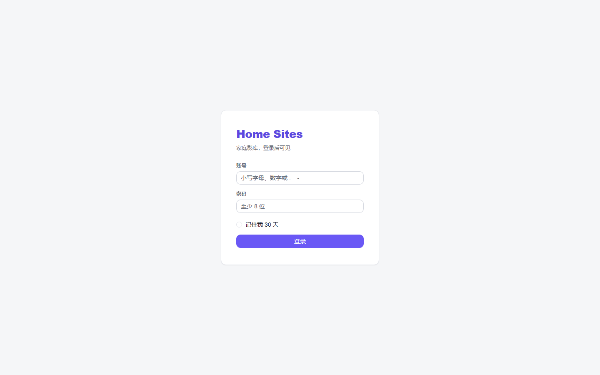

两项都空着点"登录"，是表单里的一行红字，不是顶部那条 toast：


账号或密码不对，报的是同一句，不区分哪一种错：

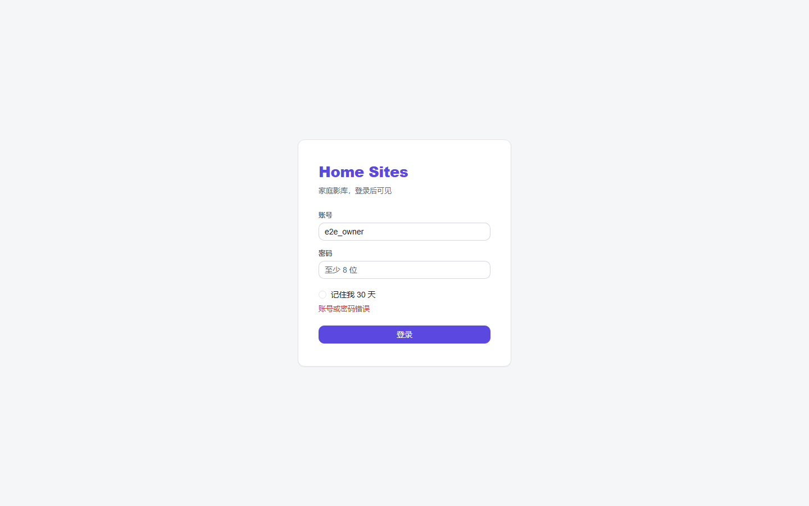

**没有"注册"入口，也没有"忘记密码"链接**——见 3.6。

### 3.2 会话有效期

| 情形 | 时长 |
|---|---|
| 普通登录 | **12 小时**（`session_hours`，默认值） |
| 勾了"记住我 30 天" | **30 天**（`remember_me_days`） |

会话在使用中会**滑动续期**。到期之后不是静默失效：任何一次请求返回 401，前端统一把你送回登录页，并把原来那一页记在 `redirect` 参数里，登录成功直接回到那一页。

> 提醒：会话 Cookie 就是登录凭据本身。它 `HttpOnly` + `SameSite=Lax`，明文 http 下会被内网里的中间人拿走，拿走等于拿走这个账号（还会随使用一直续期）。内网可以接受，但不要把这台机器暴露到公网。

### 3.3 连续输错密码会被锁

失败次数按 **(来源 IP, 账号)** 计，默认**连续 5 次失败锁 10 分钟**（`login_max_failures` / `login_lockout_minutes`）。

- 锁定期到了**自己就解开**，不用重启服务，也不用管理员介入。
- 管理员可以把人踢下线来腾出会话，但那不影响锁定计时。
- **套了反代之后这条会失真**：全家所有人的来源 IP 都压成反代那一台，某个人连错 5 次会把所有人一起关在门外。要么让 uvicorn 只信任你自己的反代并取真实来源（`--proxy-headers --forwarded-allow-ips=127.0.0.1`，且反代要转发 `X-Forwarded-For`），要么把这两个数字调成能接受的组合。

锁定期里再试，出现的是表单里那行红字（不是 toast）——「尝试过于频繁，请 590 秒后再试」，倒数着走（第 6 次尝试才被答出来，前 5 次都是"账号或密码错误"）：

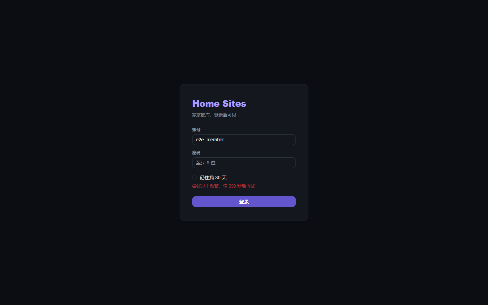

### 3.4 口令规则

- **最少 8 位**（`MIN_PASSWORD_CHARS`），**最长 72 字节**（超出报 "密码过长（上限 72 字节）"）。
- **不要求**大小写/数字/符号任何类别。
- 改密码时的两次输入一致校验在前端："两次输入的新密码不一致" / "新密码至少 8 位"。
- 改密成功提示："密码已更新，其他设备需要用它重新登录"（其他设备上的会话被撤销）。

### 3.5 两种角色

| 页面 | 管理员（owner） | 成员（member） |
|---|---|---|
| 首页 / 播放历史 / 观影统计 / 收藏 / 片单 / 视频详情 / 个人设置 | ✅ | ✅ |
| 视频源 / 标签管理 / 设置 / 用户管理 | ✅ | ❌ 菜单里就不给这一项；硬敲地址会被送回首页 |
| 详情页的"转码""编辑""删除""加标签"四个按钮 | ✅ | ❌ 按钮不渲染 |
| 系统配置和用户管理接口**读** | ✅ | ❌ 连读都 403（"需要管理员权限"） |
| 扫描丢失记录"清理丢失记录" | ✅ | ❌ |

成员**能写的**只有自己那份数据：退出登录、改自己密码、撤销自己名下某台设备、界面偏好、收藏、删除自己的播放记录、把通知标已读、标记"新片我看过了"、播放与上报进度、自己的片单（建/改名/删/加减影片）。其他任何写操作一律 403。

同一个库、同一个时刻，成员看到的顶栏少了三项（对照 4.1 那张）：

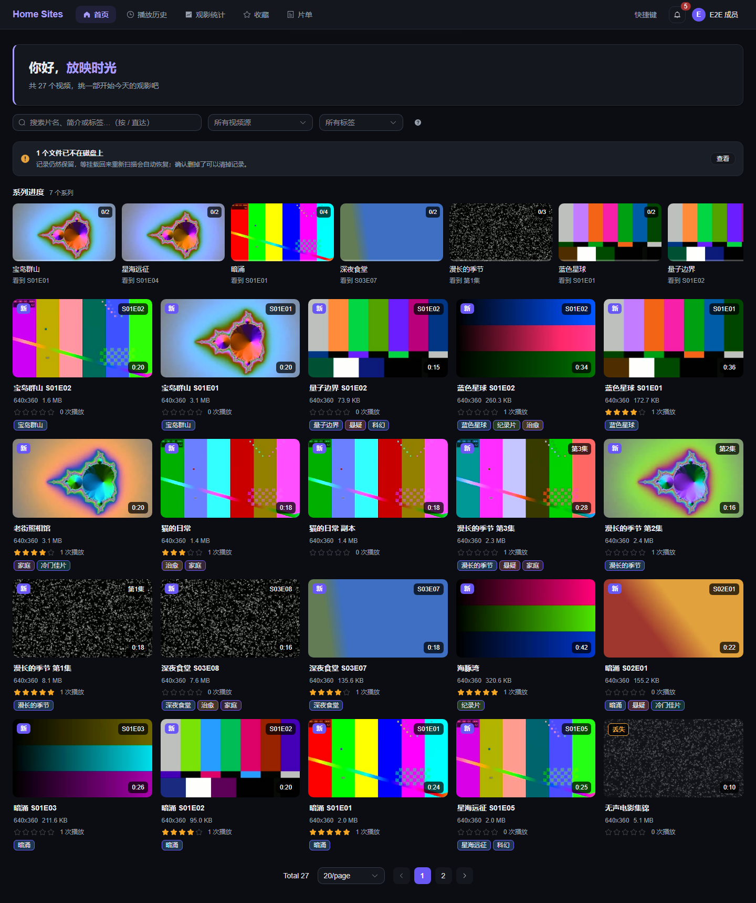

成员在详情页也拿不到那四个管理按钮，但影片照常能播：

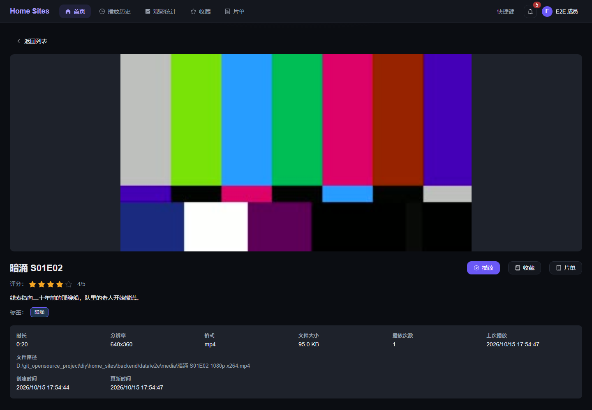

成员硬敲 `/settings` 这类地址，会被静默送回首页（不是一句报错）：

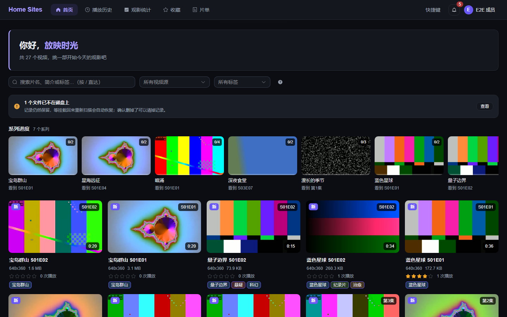

> 片库本身**对全体登录账号可见**——目前只有 owner / member 两档，没有"某个源只对某个人可见"这一层。家里之外的人不要建账号。

### 3.6 口令忘了 / 想加人

- **没有注册接口，没有自助找回**。唯一的界面途径是管理员在"用户管理"页点"重置密码"。
- 如果连管理员口令都丢了，只能上命令行（见 11.3）：`revoke-sessions` 能把人踢下线，`create-user --role owner` 能建一个新管理员。**部署前先确认自己还留着一条能进后端机器的路。**

### 3.7 我的设备

个人设置页的"登录设备"卡片，逐台列出你这个账号当前有效的会话：

| 显示内容 | 说明 |
|---|---|
| 设备名 | 从浏览器 User-Agent 推断，例如 "Chrome · Windows"；认不出就显示 UA 前 40 个字符，再没有就 "未知设备" |
| "当前设备" | 标记你正用的这一台 |
| "最近活动 …" / "有效期至 …" | 最后被使用的时间、会话到期时间 |
| 按钮 "退出" | 撤销**这一台**，成功提示："该设备已退出，下次要用密码重新登录" |
| 当前设备这一行 | 不给"退出"按钮，旁边写："顶栏的「退出登录」管这一台" |
| 按钮 "刷新" | 重新拉取列表 |

顶栏"个人设置"入口和"我的设备"是同一个页面的两件事；退出单台设备**不会**把你现在这台踢掉。

整页长这样（上半是界面偏好，含 4.3 说的主题三档）：

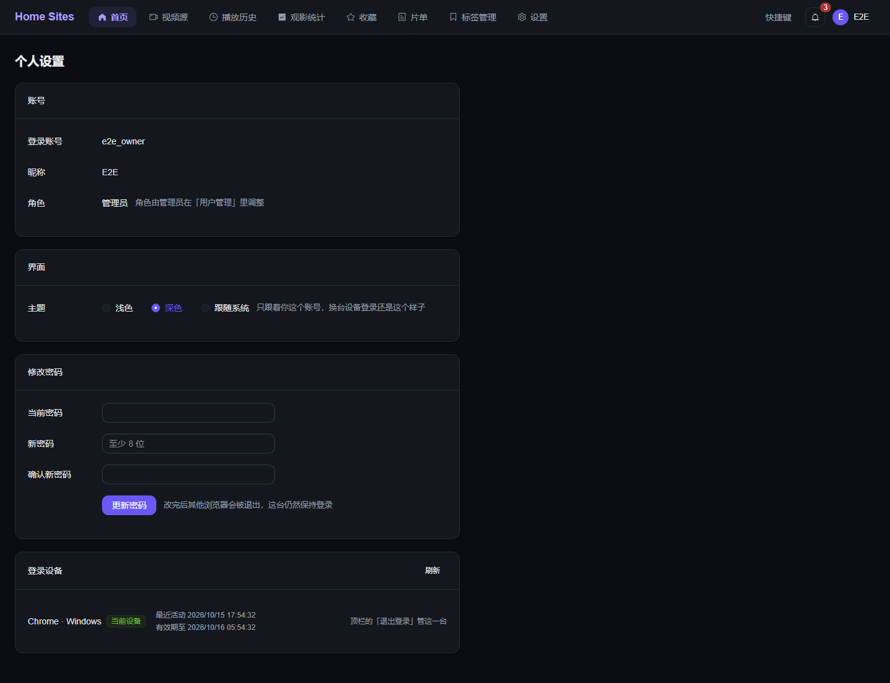

### 3.8 退出登录

右上角头像 → "退出登录"。这只管当前这台设备；别人的设备要用"我的设备"逐台撤销，或管理员在用户管理页"踢下线"。

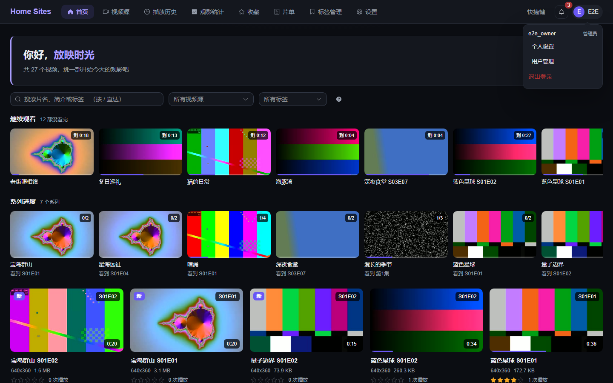

---

## 4. 界面总览

### 4.1 顶栏导航（顺序就是界面顺序）

| 顺序 | 菜单 | 谁能看见 |
|---|---|---|
| 1 | 首页 | 全部 |
| 2 | 视频源 | 仅管理员 |
| 3 | 播放历史 | 全部 |
| 4 | 观影统计 | 全部 |
| 5 | 收藏 | 全部 |
| 6 | 片单 | 全部 |
| 7 | 标签管理 | 仅管理员 |
| 8 | 设置 | 仅管理员 |


右侧三个东西：**"快捷键"按钮**（或按 `?`）、**通知铃铛**（带未读数角标）、**头像弹层**。头像弹层里依次是：你的账号名 + 角色标注（"管理员"或"成员"）、"个人设置"、"用户管理"（仅管理员）、"退出登录"。

### 4.2 快捷键

| 全站 | |
|---|---|
| `/` | 跳到首页搜索框 |
| `?` | 打开这份快捷键清单 |
| `Esc` | 关闭对话框与菜单 |

| 播放器 | |
|---|---|
| `空格` / `K` | 播放 / 暂停 |
| `←` / `→` | 后退 / 前进 5 秒 |
| `↑` / `↓` | 音量，之后会记住 |
| `M` | 静音 |
| `F` | 全屏 |

正在往输入框里打字时按 `?` 不会抢走这个按键。

那张清单是顶栏"快捷键"按钮（或按 `?`）弹出的对话框：

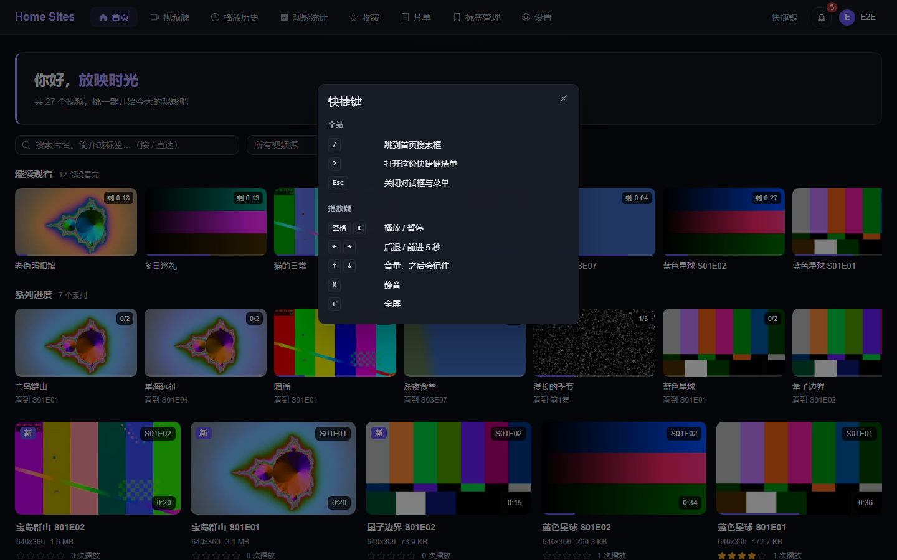

### 4.3 主题

个人设置页 → 界面 → 主题，三档单选：`浅色` / `深色` / `跟随系统`。选完立刻保存，不用点保存按钮。

新账号的默认是浅色，**本手册主体那几十张图拍的是深色**（也就是这个项目的主视觉）。同一个首页两种主题各一张：

深色主题（首页带丢失横幅那一屏）：

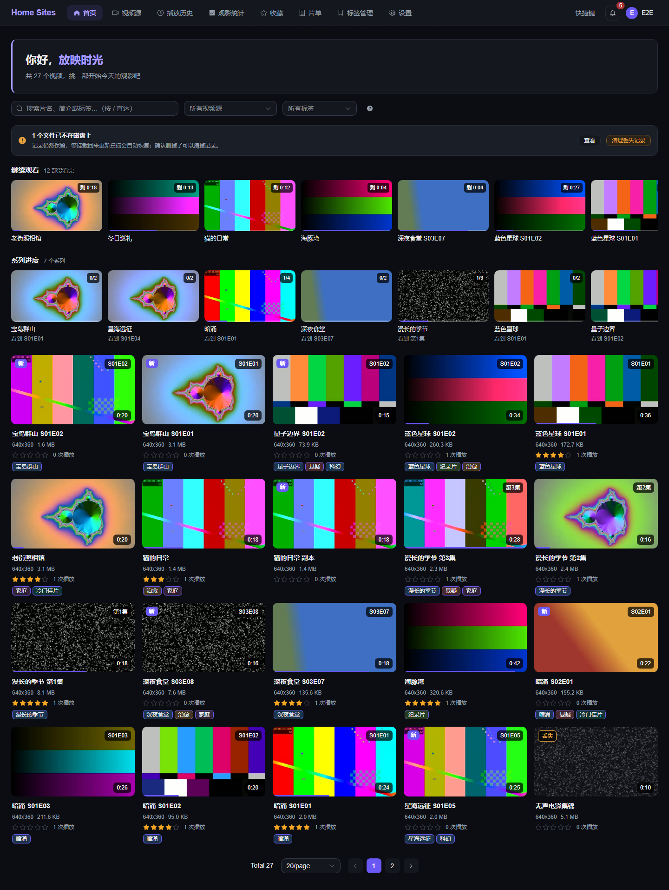

浅色主题：

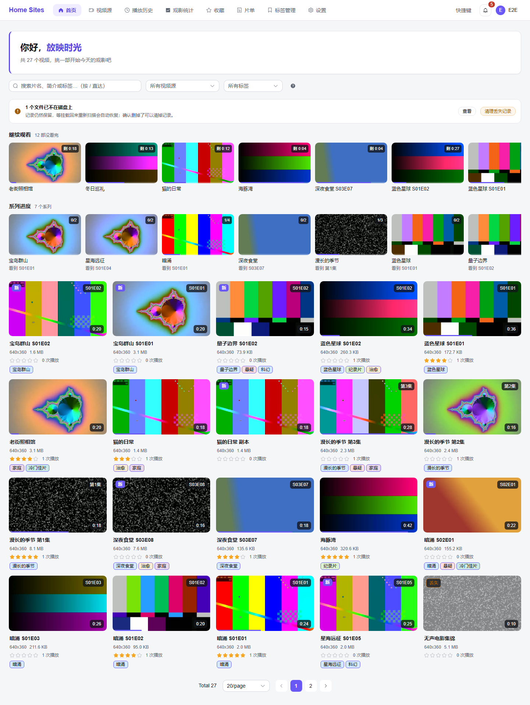

详情页也是同一回事：

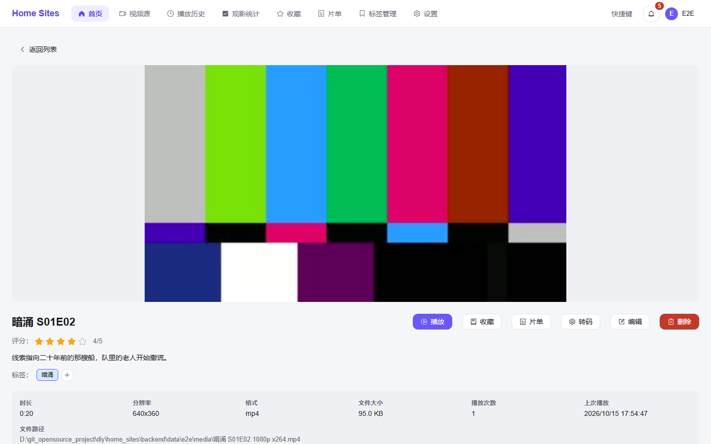

### 4.4 提示的通则

所有操作结果走页面顶部中间那条 toast，文案是中文。后端返回的校验/失败原因也已经是中文句子，会原样出现在 toast 里；本手册凡引号内的句子都是界面/接口原文，可以直接对照。

---

## 5. 找片：首页与搜索

### 5.1 首页自上而下

1. **Hero 区**：标题"你好，放映时光"，副标题"共 N 个视频，挑一部开始今天的观影吧"。
2. **工具栏**：搜索框（占位"搜索片名、简介或标签…（按 / 直达）"）、"所有视频源"下拉、"所有标签"下拉、一个圆形问号按钮（点开是搜索语法对照表）。
3. **丢失横幅**（仅当有丢失记录时，黄色）："N 个文件已不在磁盘上"，说明句"记录仍然保留，等挂载回来重新扫描会自动恢复；确认删掉了可以清掉记录。"，按钮"查看"，管理员额外有"清理丢失记录"。
4. **"继续观看"栏**：没看完的片子，卡片右上角标"剩 1:23:45"，下方细进度条；栏目标题旁写"N 部没看完"。**最多 20 部**；一旦你用了搜索或筛选，这一栏就隐藏（避免和筛选结果混在一起看不出来）。
5. **"系列进度"栏**：按系列聚合，角标"finished/total"，状态文案是"看到 S01E02"/"继续 片名"/"已看完"。这一栏不限条数。
6. **视频网格 + 分页**。默认按添加时间倒序。首页**没有**独立的"最近添加"区块和统计区块——默认排序就是最近添加。
7. **空态**："没有匹配的视频"（有筛选条件时）或"没有找到视频"，后面跟一句提示和一个"清除筛选"按钮。

整屏（这一屏有 27 部片子，所以三条栏都齐了）：

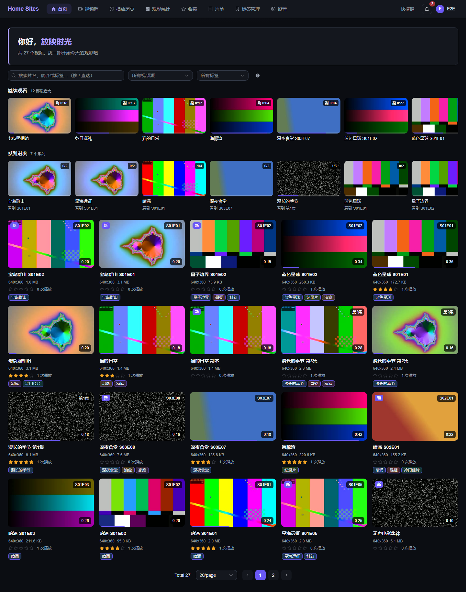

第 4 项"继续观看"单独一张——注意每张卡右上角的"剩 M:SS"和图下那条细进度：

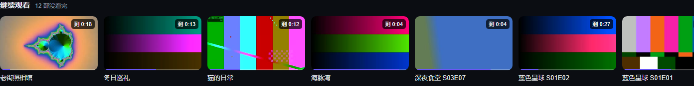

第 5 项"系列进度"单独一张——右上角是"已看/总数"，下面那行是"看到 S01E01"这类状态句：

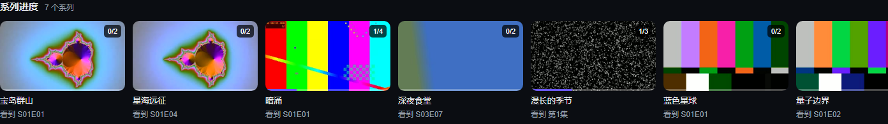

第 3 项那条横幅只在库里真有丢失记录时才出现（这里是真的删掉了一个文件、又扫了一轮之后拍的）。它压在页面最上面，右边两个按钮分别是"查看"和只有管理员才有的"清理丢失记录"：


"清理丢失记录"点下去先要确认一次（标题"清理丢失记录"，按钮"删除记录"/"再想想"），原文说清了它带走的到底是什么：

> "将删除 N 条扫描时找不到文件的记录。磁盘上的视频不会被改动，但播放历史、收藏与这些记录生成的封面会一起删除；文件回来后重新扫描会重新登记，封面也重新生成。"

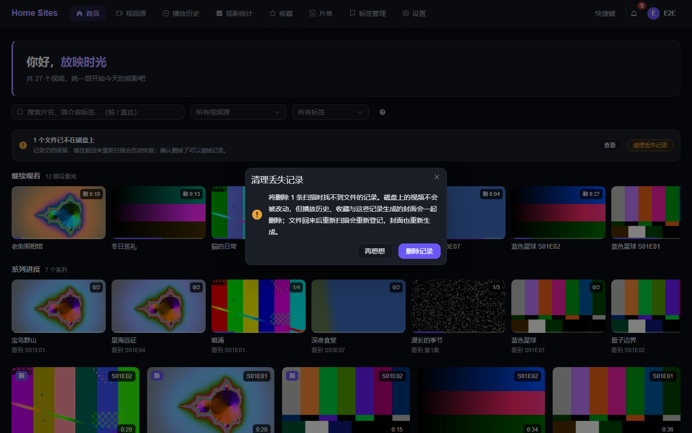

### 5.2 搜索语法

搜索框不只是匹配片名，认得的片段会被解析成条件。**多个词之间是"并且"关系**，命中范围是片名、简介、标签名。

| 写法 | 意思 | 例子 |
|---|---|---|
| `dark hero` | 两个词都要命中 | |
| `"dark hero"` | 整体匹配，不按词拆开 | |
| `标签:悬疑` `tag:悬疑` | 限定标签 | 全角冒号"标签：悬疑"也认 |
| `源:剧集` `source:剧集` | 限定视频源 | |
| `评分>=4` | 按评分比较 | 运算符可用 `>= > <= < = ≥ ≤` |
| `时长>40分钟` | 按时长比较 | 单位：小时/分钟/秒/`h`/`min`/`m`/`s`；**不带单位按分钟算** |
| `没看过` / `未看完` / `已看完` | 按你自己的观看状态筛 | |
| `丢失` / `已丢失` / `missing` | 只看文件已不在磁盘上的记录 | |

**语法写错不会有报错**：解析不出来的片段一律退回去当普通关键词，所以你看到的只是"N 个结果"变少或者"没有匹配的视频"。这是设计，不是 bug——它保证你写什么都至少还有一次关键词搜索可用。

季/集**不是**搜索运算符。它们来自文件名的自动解析（见 8.3），显示在卡片角标上。

工具栏最右那个圆形问号，点开就是这张对照表（和上面的表同一份内容，界面上更省事）：

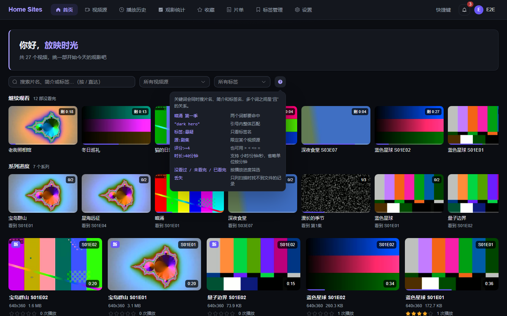

下面六张是照着上表逐条写的实际结果，可以作为"这句该长什么样"的参照。

普通关键词（命中片名、简介、标签名）：

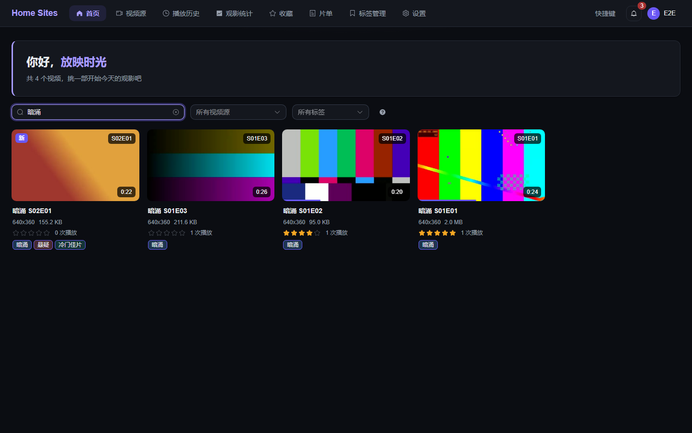

`标签:悬疑`——标签运算符：

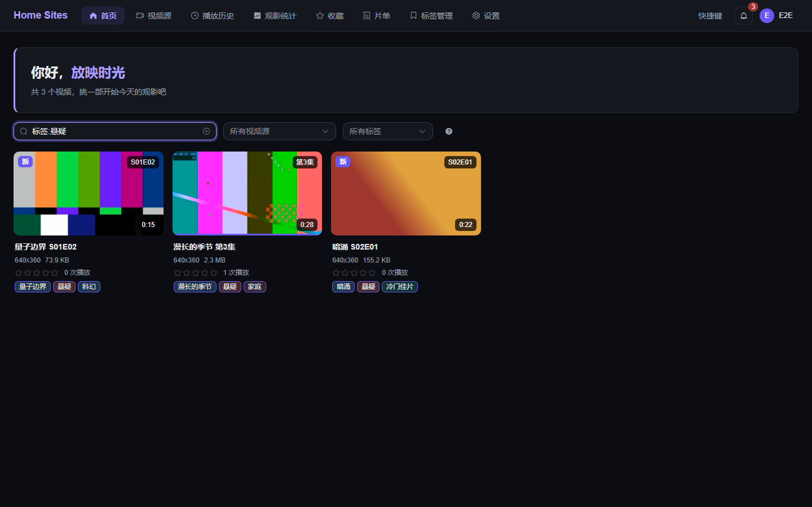

`评分>=4`——评分比较：

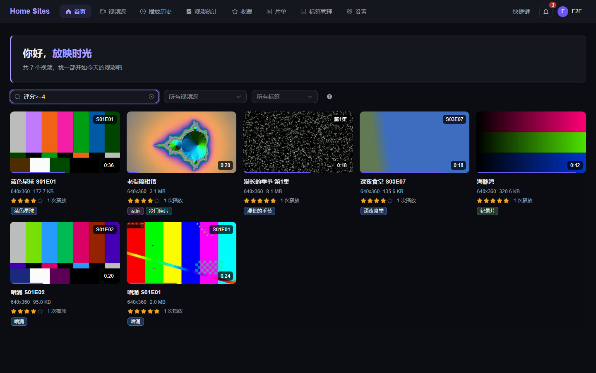

`时长>20秒`——时长比较（带单位）：

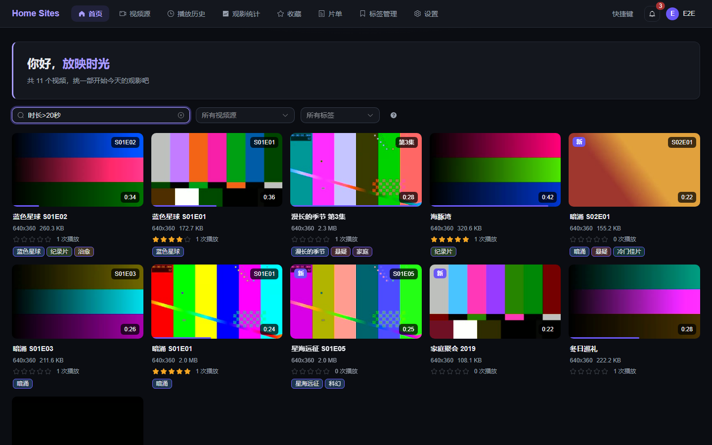

`未看完`——你自己的观看状态：

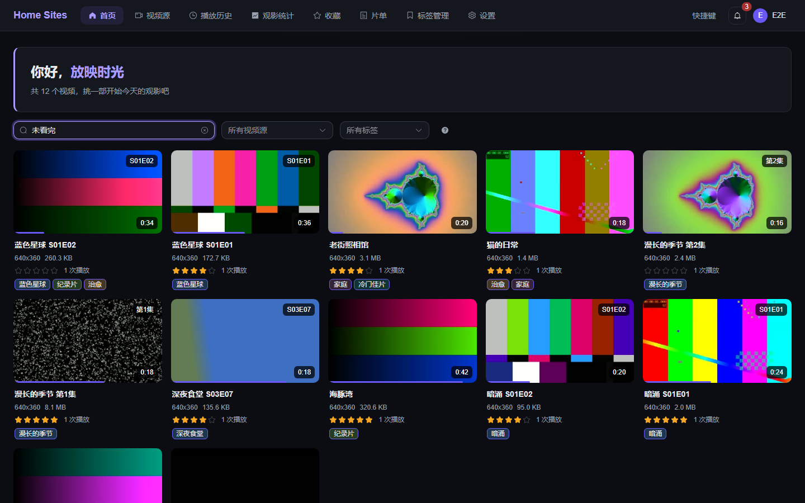

一句谁都不匹配的话，空态长这样（注意那句"清除筛选"）：

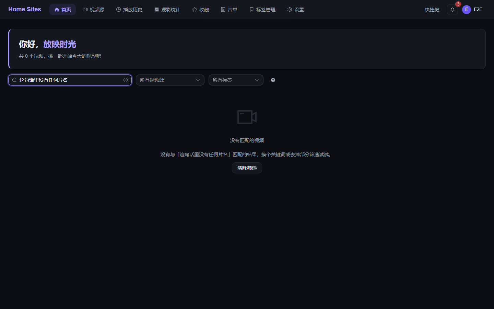

### 5.3 分页与筛选状态

- 每页条数默认 **20**，可选 10 / 20 / 40 / 60（后端硬上限 100）。
- 搜索词、源、标签、页码都会**写进 URL**。所以"把这一屏发给家人"是可以的：复制地址栏即可。
- 分页条上的字是**英文**的（"Total 27"、"20/page"），截图里就是这样，不是坏了：整站只自定义了中文文案，Element Plus 的中文语言包没有装，所以它自带的控件（分页、下拉的占位词）会露出英文。

"所有视频源"下拉展开的一刻（选项来自已登记的视频源）：

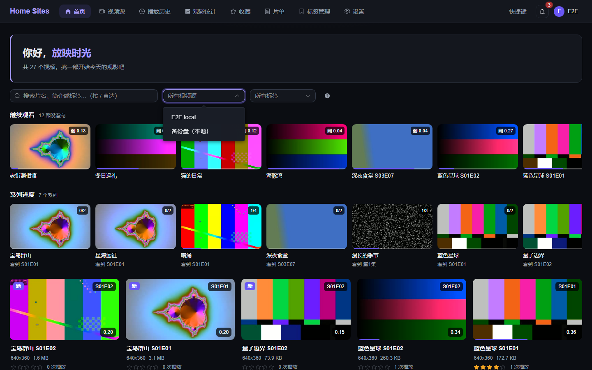

翻到第 2 页（地址栏里的 `page=2` 就是这一跳写进去的）：

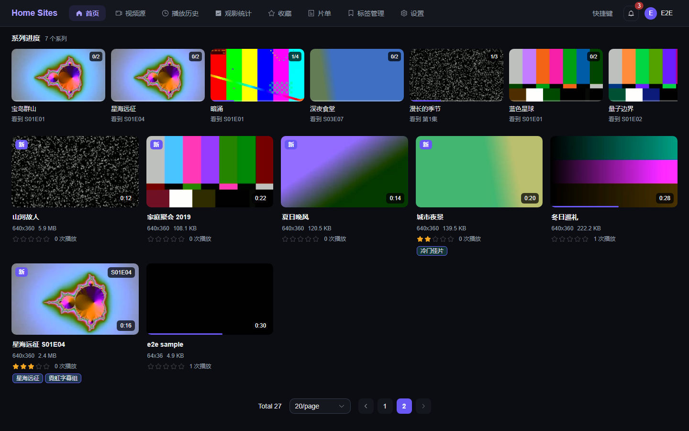

### 5.4 一张卡片上有什么

| 位置 | 内容 |
|---|---|
| 缩略图 | 扫描时抽的封面；没有封面时是占位 |
| 右下角标 | 时长 |
| 右上角标 | 集数，后端算好的字符串：`S01E02` 或 `第12集` |
| 左上角标 | "新"（实心，走主题强调色，深色主题下是紫色）或"丢失"（描边黄字），二者互斥 |
| 图下细条 | 你的续播进度（已看到 ≥99.5% 就不显示） |
| 正文 | 标题、分辨率、文件大小、5 星评分、"N 次播放"、最多 3 个标签 +「+N」 |

点整张卡进详情页。"新"是扫描时打的标记，**你第一次播放它就自己消掉**。丢失的记录缩略图会压暗到 45% 左右。

这张是"新"那一档的特写：左上紫底"新"、右上是后端算好的集数角标 `S01E02`、右下是时长 `0:20`。

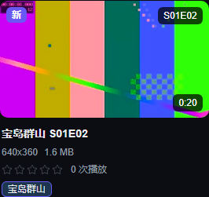

同一种卡在文件真丢了之后长这样——左上角换成描边黄的"丢失"（"新"就不出现了，两者互斥），整幅封面压暗：

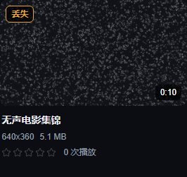

---

## 6. 看片：详情页与播放器

### 6.1 详情页信息区

顶部有"返回列表"。未开始播放时显示封面和播放大按钮（没封面时是"暂无预览" + "播放视频"按钮）。

元数据栏的字段名（原文，顺序照界面）：

> 时长 / 分辨率 / 格式 / 文件大小 / 播放次数 / 上次播放 / 文件路径 / 创建时间 / 更新时间

空值的显示法：数值缺失显示"N/A"或"未知"，从没看过显示"从未"。另有"评分："（星级 + `x/5`）和"标签："（末尾一个小加号按钮，弹"编辑标签"）。

按钮清单：

| 按钮 | 谁能看见 | 点了之后 |
|---|---|---|
| "播放" / 播放中变"停止" | 全部 | 起播放器 |
| "收藏" ⇄ "已收藏" | 全部 | "已添加到收藏" / "已取消收藏" |
| "片单" | 全部 | 弹"加入片单"：空态"还没有片单。下面起个名字，这部就是第一条。"，输入框"新建片单并加入（可选）"，每个已有片单后面标"N 部"，按钮"取消"/"保存"，成功"片单已更新" |
| "转码" | 仅管理员 | 进这部片的转码页 |
| "编辑" | 仅管理员 | 标题变"编辑视频信息"，字段"标题"/"描述"/"评分"，按钮"取消"/"保存"，成功"视频信息已更新" |
| "删除" | 仅管理员 | 确认框"确定要删除 "片名" 吗？"，标题"确认删除"，按钮"删除"/"取消" |

> 编辑过的标题**不会被下一次扫描覆盖**——扫描只在文件名解析结果和库里记录不同时回填那些自动字段，手工改的标题留着。

删除一部片会连带删掉：应用生成的封面文件、转码产物文件、它的全部播放记录/收藏/片单条目/标签关联。**磁盘上的影片源文件不动。**

详情页整屏（这部片挂了标签、有评分、有简介，所以下面几块都在）：

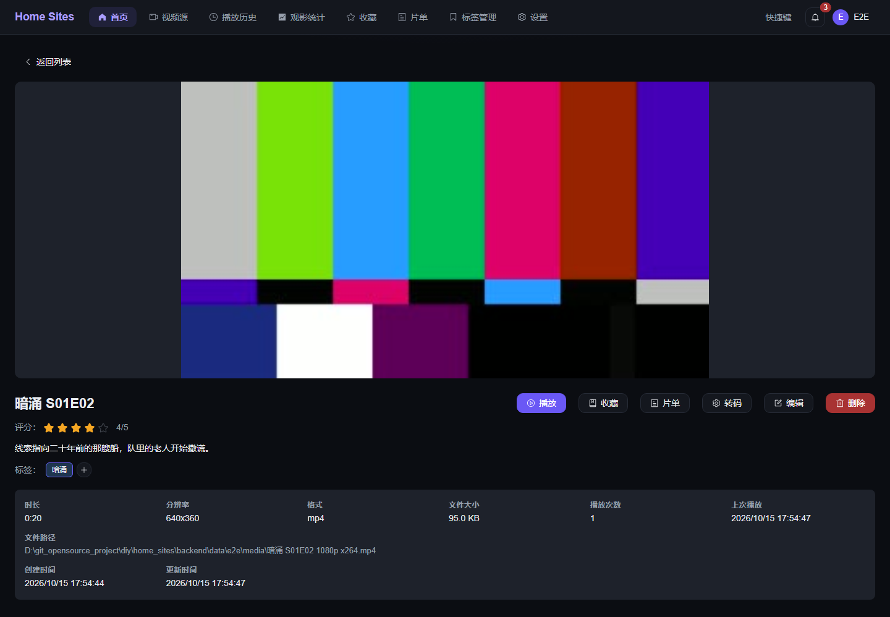

元数据栏单独一张，字段名和顺序就是界面上的顺序：

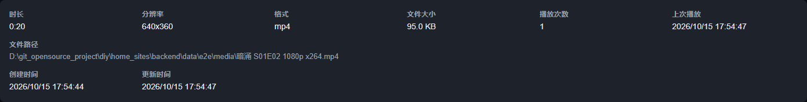

点"编辑"之后标题区就地变成表单（不是弹窗）：

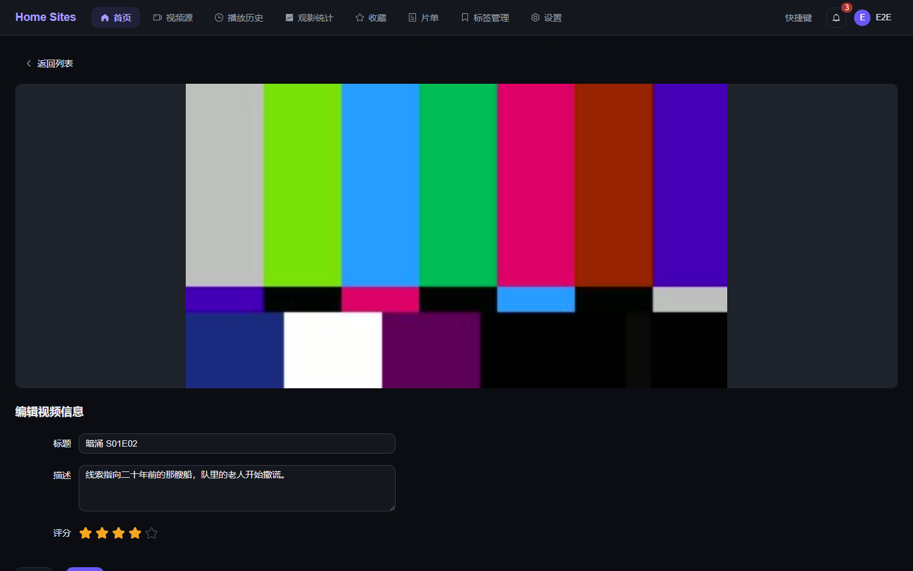

"标签："旁那个小加号弹出的对话框，勾完即存：

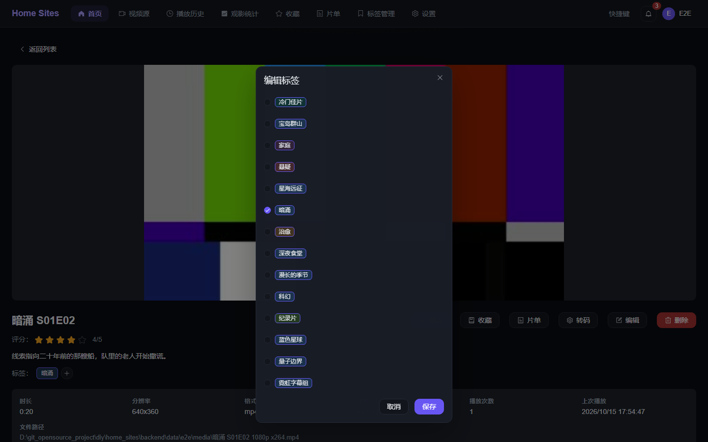

"片单"按钮弹的那一层，每个已有片单后面标着它当前有几部：

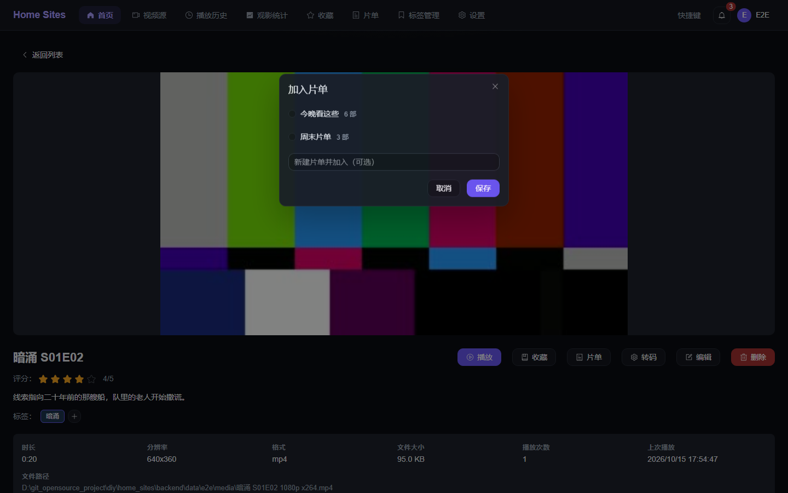

"删除"的确认框（点"取消"什么都不会发生）：

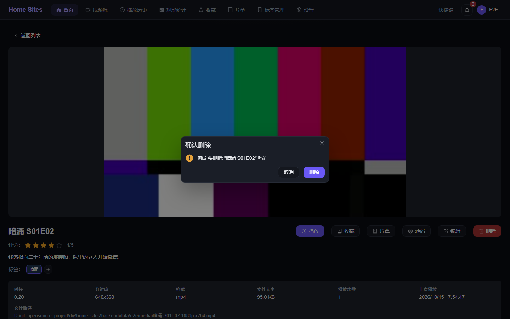

### 6.2 播放器控制条（从左到右）

这个播放器是**自绘控件**，不用浏览器原生 `controls`，所以你能看到的操作就是下面这些：

| 控件 | 说明 |
|---|---|
| 播放 / 暂停 | 点击画面中央也能切 |
| "后退10秒" / "快进10秒" | 图标是 10 + ↺/↻ |
| 进度条（title"跳转"） | 拖动时时间跟着手走，**松手才上报进度**；A-B 区间会用一段高亮窗显示在进度条上 |
| A / B / ✕ | "设置 A 点（当前播放位置）""设置 B 点（需晚于 A 点）""清除 A-B 区间" |
| 时间 | `0:12 / 1:30:00` |
| 静音 + 音量滑条 | |
| 倍速 | 按钮显示当前档位（如 `1x`），菜单里 0.5 / 0.75 / 1 / 1.25 / 1.5 / 2 |
| CC | 字幕菜单，见 6.4 |
| 全屏 | |

播放中把鼠标停在画面上，控制条就会出现（起播 3 秒后自动收起，鼠标移出播放器立刻收起）：


整页在播放中的样子：

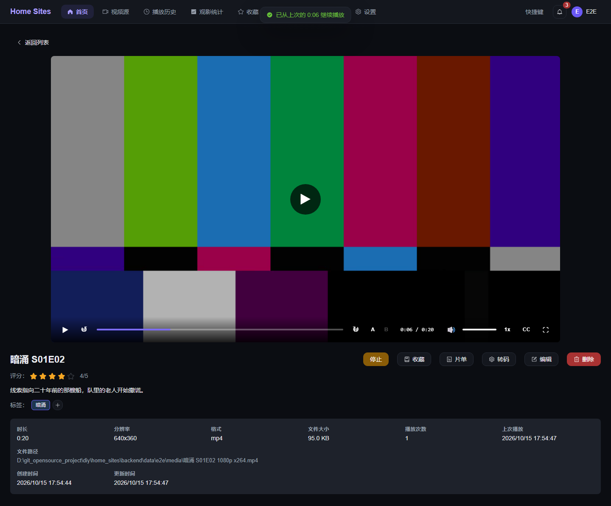

"倍速"按钮点开是这六个档位，按钮上的字会跟着变：

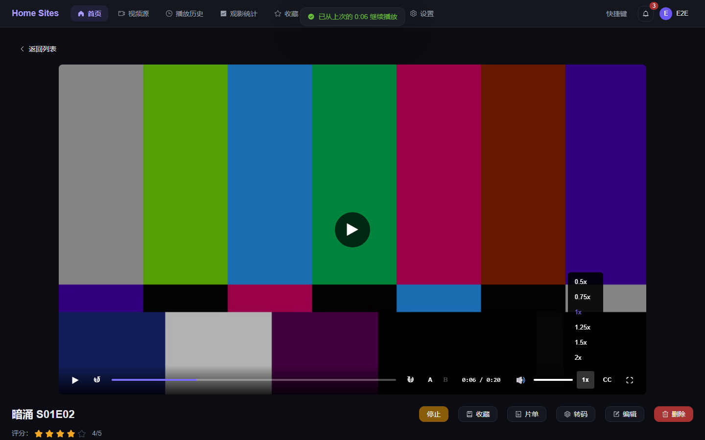

A-B 区间：设了 A 点、又设了晚于它的 B 点之后，进度条上会出现那一段高亮窗，右侧多出一个"清除 A-B 区间"的按钮：

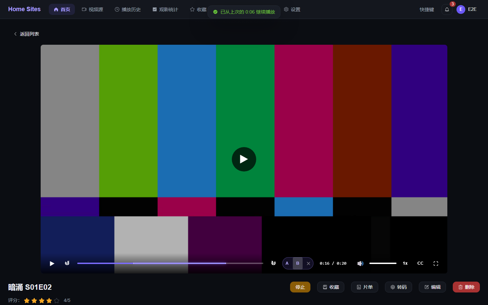

### 6.3 从上次位置继续

播放**自动**从你上次的位置开始，不问一句"要继续吗"。规则是：

- 上次的记录必须**大于 3 秒**、且**早于总时长减 5 秒**，才会跳过去（开头和结尾那一小截不值得跳）。
- 跳成功会有 toast："已从上次的 12:34 继续播放"。

**如果你在影片信息还没到时就点了进度条**，那一次点击不会被丢掉：应用把它记成百分比，等元数据到达后补做。补做时**优先用你点的位置**，不再执行续播跳转——也就是说"我明确点了哪儿"大过"上次看到哪儿"。换源或重新加载视频（`loadstart`）会作废那个待补的位置；"元数据永远不来"那种情况没有加超时兜底，播放器就停在那儿等你重试或退出。

### 6.4 字幕

两种来源，都汇到 CC 菜单里。菜单从上到下是：**"关闭" → 外挂字幕列表 → 分组标题"文件内嵌" → 内嵌轨列表**。

这部片有两个外挂 sidecar（中、英各一条），所以菜单上半是两条、下面跟着字号与延迟那两行；它没有内嵌轨，所以"文件内嵌"那级分组标题在这张图里不出现：

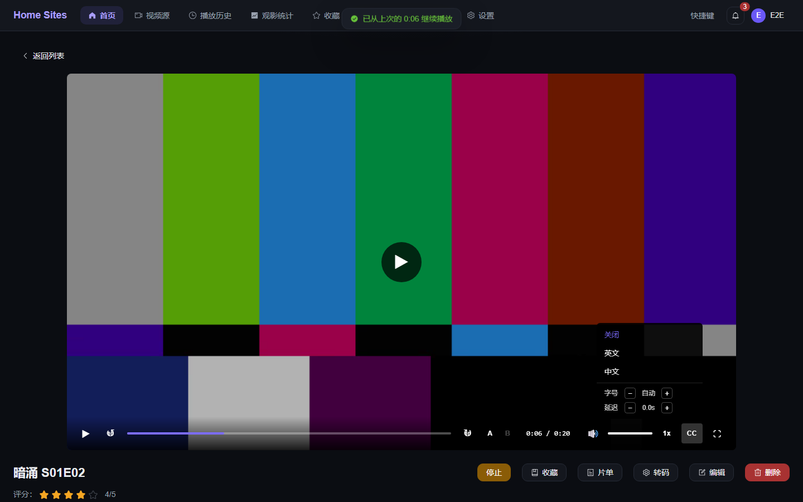

挑一条"中文"、菜单收起之后，cue 就压在画面下沿，右下角那个 CC 按钮此时是亮着的：

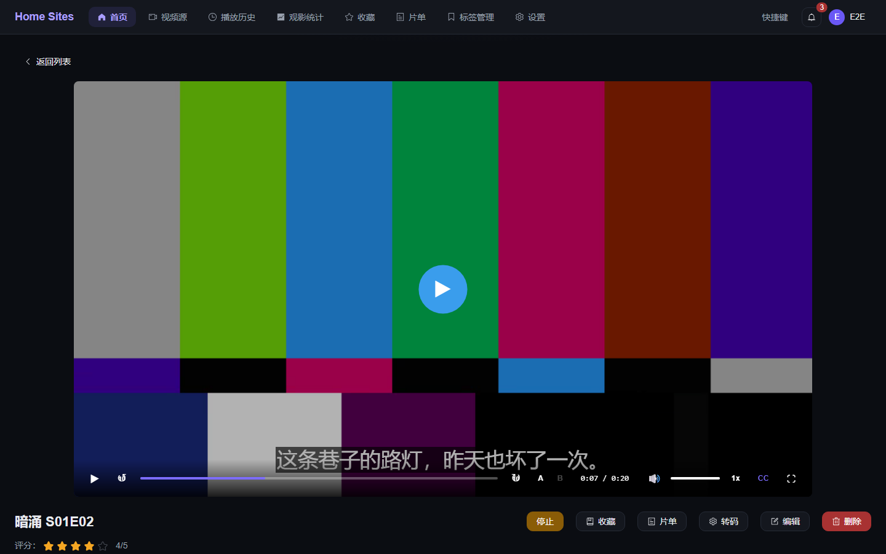

**外挂文件（sidecar）命名规则**（支持 `.srt` / `.ass` / `.ssa` / `.vtt`）：

```
movie.srt            movie.zh.srt            movie.mp4.zh.srt
```

也就是字幕文件必须和影片同目录、同名起头，中间可选地插一层容器扩展名，语言代码用点号隔开。**只有本地 / NAS 源支持外挂字幕**；对象存储源会被明确拒绝（"外挂字幕只支持本地或 NAS 视频源…"）。手工登记字幕要求文件确实落在视频同目录内，并且当场试读一次。

**菜单里那条字幕叫什么**：优先用字幕文件自己带的 `title` 标签；没有就按语言代码给中文名带地区，例如"中文（CN）"；两条都认不出就是"轨道 N"（前端最后兜底为"字幕 {id}"）。

**加载失败会说话**：菜单条目后面追加"（加载失败）"，并弹 toast「字幕「X」没能加载」。后端相关的两句原文：

- 文件里一条 cue 都没解析出来 → "字幕转换失败：这份文件里没有解析出任何一条字幕（{ext}）"
- 文件不在 → "字幕文件不存在"

**编码**：带 BOM 的 UTF-16 / UTF-8 按 BOM 判；**不带 BOM 的 UTF-16** 靠 NUL 字节占比嗅探并判大小端；纯 UTF-8 解失败则回退 **GB18030**（GBK 系）以替换字符解码。也就是说常见的GBK 老字幕能直接看，不需要先转码。

**字幕样式**：菜单底部还有"字号"（−/数值/+，可点"自动"，范围 14–40）和"延迟"（每次 ±0.5 秒，范围 −15～15 秒，可"归零"）。

**图像字幕放不出来**（PGS/VobSub 那一类）：会提示"N 条图像字幕浏览器放不出来"。浏览器不做图像字幕解码，这种片子要先转码或找外挂文本字幕。

### 6.5 音轨

多音轨时播放器会提示"音轨 …，浏览器不能切内嵌音轨"。**这是浏览器的限制，不是没做**：`<video>` 元素不支持切换内嵌音频轨。要换语言音轨，用第 9 章的转码单独出一版。

---

## 7. 收藏 / 片单 / 播放历史 / 统计 / 标签

### 7.1 收藏

标题"我的收藏"，空态"暂无收藏视频。"。卡片上有"播放"和"移除"两个按钮；移除确认框"确定要将 "片名" 从收藏中移除吗？"（标题"确认移除"，按钮"移除"/"取消"），成功"已从收藏中移除"。分页默认 20，可选 10/20/40/60。加收藏只能在详情页做，这一页没有批量操作。

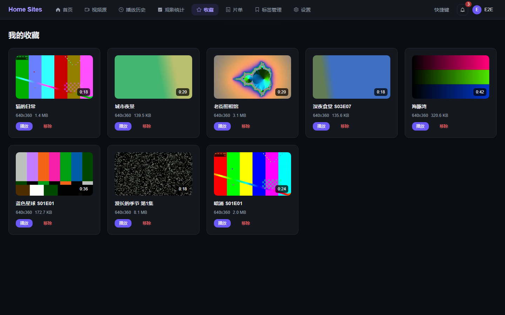

### 7.2 片单

标题"片单"，旁边汇总"N 个片单 · M 条排队"，右上"新建片单"。空态："还没有片单。建一个，把今晚想看的几部丢进去。"

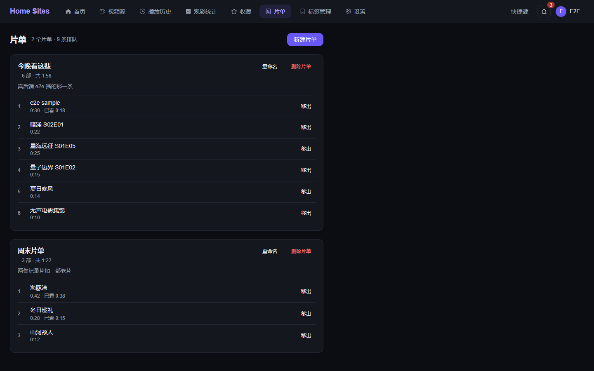

每个片单是一个面板：片单名 + "N 部 · 共 1:23:45"，右上"重命名""删除片单"；下面是编号列表，每条显示标题 + 时长 + "已看 M:SS"，右侧"移出"（成功"已把「片名」移出片单，影片仍在库里"）。空片单写"这个片单还空着，去影片详情页点「加入片单」。"

删除确认："将删除片单「X」及其 N 条排队记录。影片本身不会被动。"
新建/重命名弹窗：标题"新建片单"/"重命名片单"，输入框占位"名字，例如 今晚看这些"和"备注（可选）"，按钮"取消"/"保存"；名字留空报"片单要有个名字"。

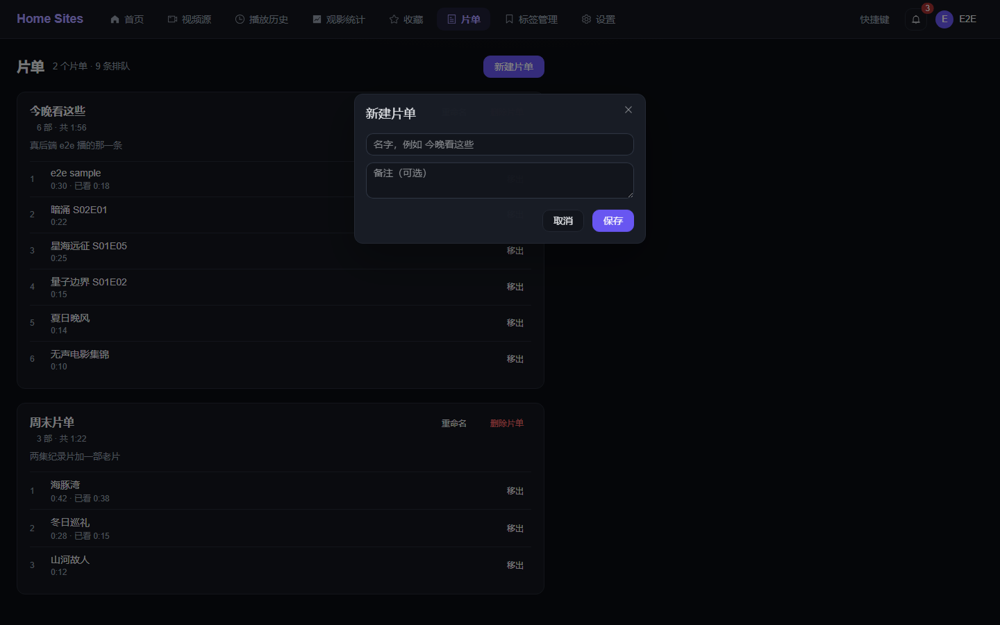

片单名在**同一个账号下不能重复**（数据库层有唯一索引）。这一页一次拉全部，没有分页。

### 7.3 播放历史

上半是"继续观看"卡片区（和首页同一份数据），下半是"观看历史"表格，列是：**视频 / 进度 / 状态 / 最后观看**，最后一列空表头放删除按钮。状态标签是"已完成"或"未看完"。

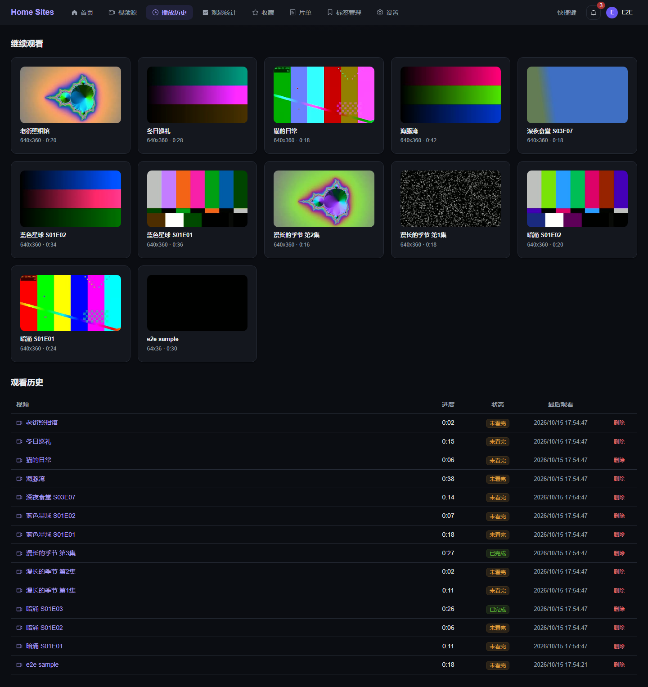

- 只按影片列，**不按日期分组、不按日期聚合**。
- 每行可删（确认"确定要删除这条播放记录吗？"，成功"播放记录已删除"）。**只能单条删，界面上没有"清空全部历史"**。
- 分页默认 20，可选 10/20/40/60。空态"暂无观看历史。"

### 7.4 观影统计

时间范围按钮：**"近 7 天" / "近 30 天" / "近 90 天" / "近一年"**，默认 30 天。

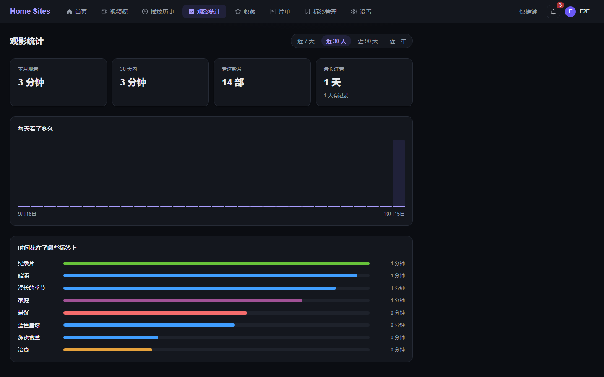

四张指标卡（原文名）：**本月观看** / **N 天内** / **看过影片** / **最长连看**（最后一张带注脚"N 天有记录"）。

两张图：

| 图 | 空态文案 |
|---|---|
| "每天看了多久"（柱状，轴标签是"7月7日"式） | "这段时间还没有观看记录，播放任意视频后再回到这里。" |
| "时间花在了哪些标签上"（按标签配色横条） | "看过的影片还没有标签，给它们打上标签后这里就有内容了。" |

换到"近 7 天"之后，第二张指标卡的名字（"30 天内"→"7 天内"）和柱状图横轴的起点（"9月16日"→"10月9日"）会一起跟着变：

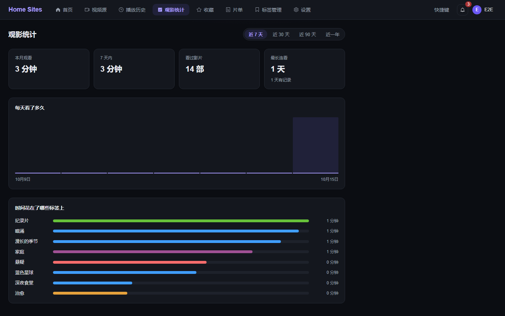

时长显示规则：不足 1 小时写"N 分钟"，否则写"N.N 小时"。统计只算你自己的观看记录。

### 7.5 标签管理（仅管理员）

建/改标签的表单：**"标签名称"**（上限 100 字，带字数计数）、**"颜色"**（取色器 + 10 个预设色块）、**"预览"**。

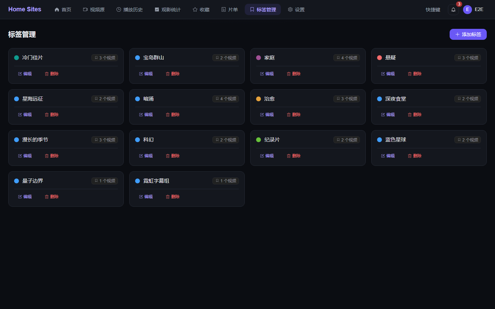

- **首尾空格会被裁掉**（前端裁一次，后端再裁一次）。裁完是空的报："标签名不能为空"。
- 重名报："标签「X」已存在"。
- 默认色 `#409eff`。取色器允许调透明度，但**透明度那一档会被丢掉**——回写的 8 位十六进制被截成 6 位（库里只存 `#RRGGBB`）。点"清空"颜色也会回到默认色。
- 删除确认："确定要删除标签 "X" 吗？这将同时从所有关联的视频中移除该标签。"（标签本身删掉，影片还在）

取色器展开后的样子（右侧那块带透明度滑杆的面板就是它）：

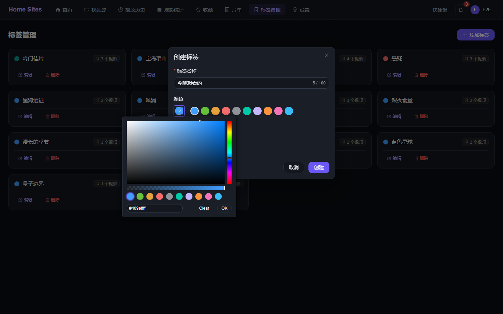

标签卡片显示"N 个视频"。**给某部片挂标签是在影片详情页做的**（"标签："旁那个小加号），不是在标签页。

自动标签：扫描时按文件名解析结果自动打一部分（见 8.3）。手工挂的标签不会被下一次扫描抹掉。

---

## 8. 管理员：视频源与扫描

### 8.1 新增源的表单字段

| 字段 | 占位/默认 | 校验 |
|---|---|---|
| 名称 | "例如：我的NAS" | 必填，1–255 个字符。"请输入视频源名称" |
| 类型 | 默认 `本地` | 未选报"请选择类型" |
| 路径 | 占位 "例如：/mnt/videos 或 \\nas\media" | 必填，1–1024 个字符。"请输入路径"；类型和路径不匹配会被后端拒绝 |
| 扫描间隔 | 初值异步取自设置页（第 10 章）的"扫描间隔" | 数字框，**最小 60 / 最大 86400 秒，步长 60**。未设置报"请设置扫描间隔" |
| 启用 | 默认开 | — |

视频源页整屏（每个源一张卡片，卡片底部是"扫描""编辑""删除"三个按钮）：

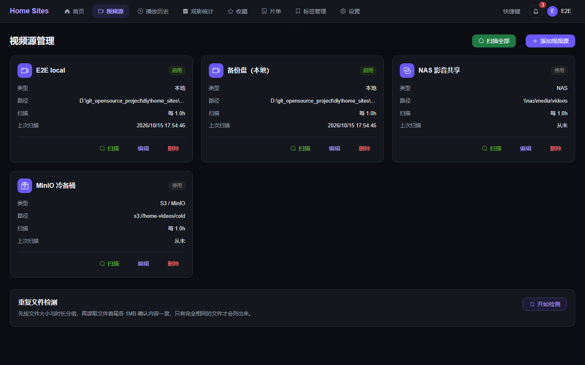

点"添加视频源"弹出的表单，字段就是上表那五项：

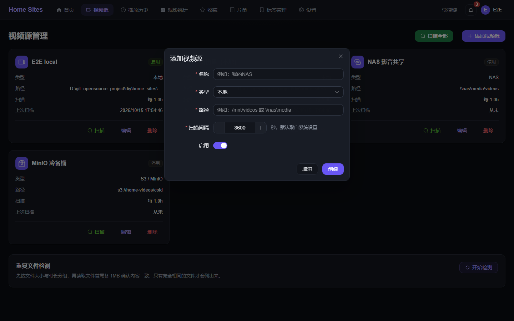

### 8.2 三种源类型，能力差别很大

| 类型 | 卡片图标 | 能扫描 | 能直接播 | 有封面 | 时长/分辨率 | 转码 | 内嵌字幕 | 外挂字幕 |
|---|---|---|---|---|---|---|---|---|
| 本地 | VideoCamera | ✅ | ✅ | ✅ | ✅ | ✅ | ✅ | ✅ |
| NAS | Connection | ✅ | ✅ | ✅ | ✅ | ✅ | ✅ | ✅ |
| S3 / MinIO | Box | ✅ | ✅（分段流式） | ❌ | ❌ | ❌ | ❌ | ❌ |

对象存储源被挡下的统一原因句："对象存储里的文件没有本地路径，转码、缩略图与内嵌字幕暂不支持这类视频源"。表单里对应提示原文："对象存储里的影片可以直接播放，但没有缩略图、转码和字幕…需要在 backend/.env 里配置 S3 凭证"。S3 配置项全在 `.env`（见附录 A），界面上没有。

凭证没配时报："尚未配置对象存储凭证，请在 backend/.env 里设置 S3_ACCESS_KEY_ID 与 S3_SECRET_ACCESS_KEY"；没装依赖时报："请安装后重启服务：pip install -e \".[s3]\""。

### 8.3 扫描一轮到底做什么

按顺序：

1. 列出该目录下的影片文件；未登记的新文件建记录，打上"新"标记。
2. 用 ffprobe 探测时长、分辨率、格式（非本地源跳过这一步）。
3. 抽封面缩略图（仅本地/NAS）。
4. 解析文件名得到标题、系列名、季、集，并据此**自动打标签**；集数角标字符串（`S01E02` 或 `第12集`）也是这里算的。
5. 登记同目录的 sidecar 外挂字幕（命名规则见 6.4）。
6. 对已存在的行回填那些自动字段（手工编辑过的标题不动）。
7. 核对丢失：源可达时，把找不到的行标成"丢失"，**不删记录**。
8. 清掉文件已经消失的外挂字幕行。

**扫描结果通知**（顶栏铃铛）原文：标题"扫描完成"，消息"视频源 {名字} 扫描完成，发现 {N} 个新视频"，按实际情况追加下面这些片段：

> "、{n} 条字幕" · "，{n} 个文件已找不到" · "，{n} 个文件已找回" · "，{n} 条字幕文件已不存在"

**零新增且无任何变化时不发通知**（不会每轮刷屏）。`scan_error` 只有一条会真正发生的产口：**定时任务**扫某个源失败（标题"定时扫描失败"）。界面上手动点"扫描"或"扫描全部"失败都是走 toast 报后端原因，不写这条通知。代码里另有一条标题"全量扫描失败"的通知，它属于 `scan_all_active_task`，而这个任务至今没挂进调度器（`scan_scheduler.py` 只挂了单源定时扫描和两个备份任务），正常运行中不会出现。

界面上手动扫描的提示（原文）：单源 `扫描 "名字" 完成: 发现 X 个文件, Y 个新视频`，全部源 `扫描完成: 发现 X 个文件, Y 个新视频`。注意这两个数字的口径：前者是"发现的**文件**数 / 其中**新视频**数"，和通知里的"新视频"不是一回事。

点下"扫描全部"之后，界面唯一的动静就是右上角那颗按钮自己转圈（文字仍是"扫描全部"，只有图标换成加载圈；每张源卡上的"扫描"按钮不变），没有百分比（原因见 8.6）：

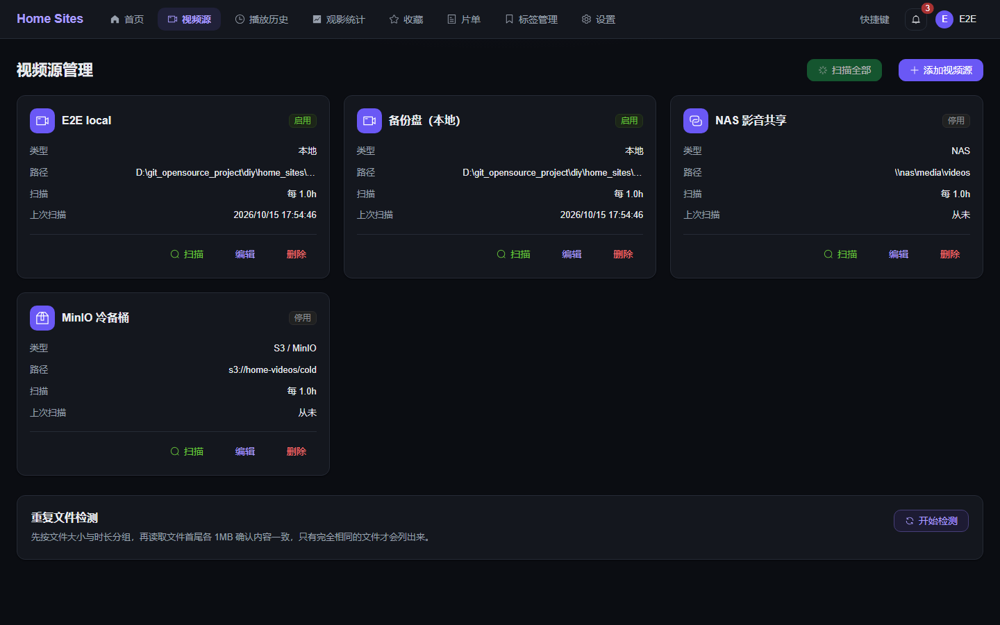

整轮跑完才在页面顶部中间落一条提示，这一句就是上面说的"全部源"那条原文：

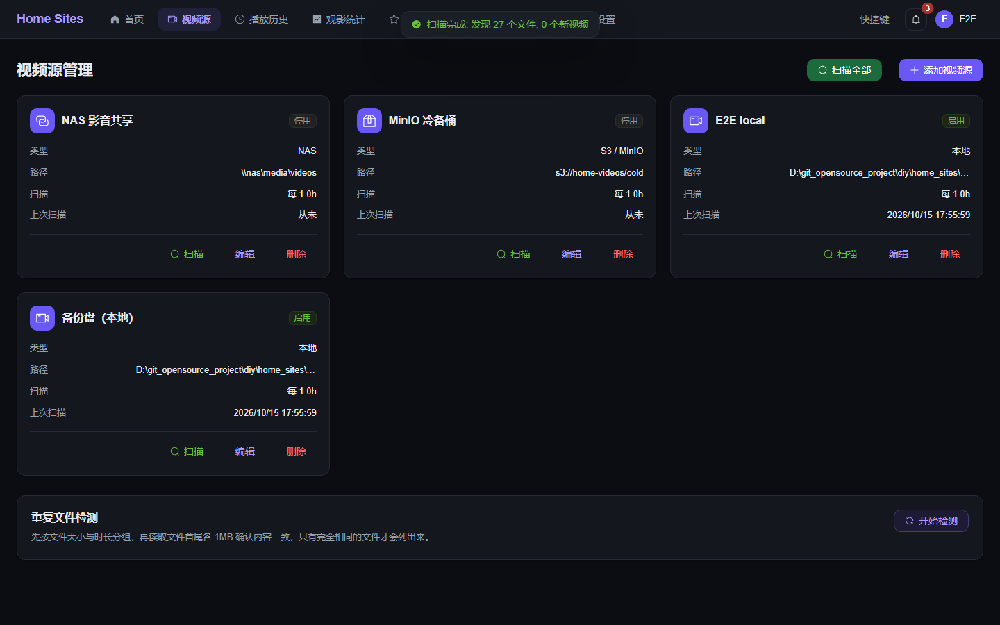

### 8.4 "自动扫描"开关和间隔的真实分工

这三处很容易搞混，说清楚：

| 在哪 | 叫什么 | 实际作用 |
|---|---|---|
| 设置页 | "自动扫描"（默认开） | **总闸门**：定时任务每一轮开始时现读这一位，关了就整轮跳过。改了下一轮生效 |
| 设置页 | "扫描间隔"（默认 3600 秒） | **只作为新建源时的默认间隔**，不改动已经存在的源 |
| 每个源自己的"扫描间隔" | 视频源页那个数字框 | **真正决定这个源多久扫一次**（调度器用的是它） |

所以：改设置页的"扫描间隔"之后，已有源的节奏**不变**；要改已有源的节奏，去视频源页编辑那个源。

### 8.5 删除一个源会带走什么

删除确认："确定要删除视频源 "名字" 吗？"（标题"确认删除"，按钮"删除"/"取消"），成功"视频源已删除"。


后果（这是最容易误解的一条）：

- 该源下所有**影片记录**被删；
- 应用自己生成的文件被删：**封面缩略图**、**转码产物文件**；
- **磁盘上的影片源文件一律不删**；
- 该源的定时扫描任务被移除。

播放记录、收藏、片单条目随影片记录一起消失（外键级联）。

### 8.6 界面上没有的两件事

后端有 `GET /api/scan/progress` 和 `POST /api/scan/stop` 两个接口（都不带源 id，管的是当前那一轮），但**视频源页没有接它们**。所以：

- 手动扫描**没有实时进度条**，要等整轮跑完才出提示；
- 界面上**没有"停止扫描"按钮**。

一轮扫描卡住时，可用的手段只有重启服务。别在手册之外的地方向你家人承诺"能看进度/能停"。

另外，**两个源指向同一个目录**（或同一份片子被挂了两次）时不会报错，也不会重复登记：`videos.filepath` 是全库唯一的，第二个源扫到已被别的源占住的路径就**跳过**，日志里写"跳过 …：这条路径已属于视频源 N"。但界面上不会告诉你为什么那批文件没出现——扫描结果里那个 `foreign_paths` 计数没有透出到页面。想知道原因只能看后端日志，或者干脆**别让两个源覆盖同一个目录**。

### 8.7 重复文件检测（视频源页底部那张卡）

标题"重复文件检测"，说明句原文："先按文件大小与时长分组，再读取文件首尾各 1MB 确认内容一致，只有完全相同的文件才会列出来。" 右侧那颗按钮第一次点叫"开始检测"，跑过一轮之后变成"重新检测"。

- 没有命中时写："没有发现内容完全相同的文件。"
- 有命中时先给一行汇总："N 组重复，多占 M 份 · 可回收 X GB"。下面每组一块：标题"N 份相同的文件"，元数据行"每份 大小 · 时长 · 多占 大小"；组内每条列出片名（没有片名时是完整路径）、绝对路径、"看过 N 次"，有进度再加"· 进度 …"，记录已丢失再加"· 文件已丢失"。
- "建议保留"那枚绿标打在内容相同的几条里**观看历史最厚**的那一条上（按 浏览次数 → 进度 → 最早登记 依次决定），列表也把它排在第一个。
- 两个删除入口：组级的"移除多余记录"（留下那条，删掉其余）和每条自己的"移除记录"。两者都先弹确认框（标题"确认移除记录"，按钮"移除记录"/"再想想"），原文："将从库里移除 N 条记录。磁盘上的视频文件不会被动，但记录生成的封面会一并删掉；要腾出空间请到文件管理器里删掉视频本体，否则下次扫描会重新收录。"
- 成功提示分别是"已移除这条记录"和"已移除 N 条重复记录"；失败是"移除失败: …"，检测本身失败是"检测失败: …"。
- 一次检测最多读 300 个候选文件（按"能腾出多少空间"从大到小排着读），超出预算的组这一轮不探测、也就不会出现在报告里。文件很多时多点几次"重新检测"没有意义，先把大头的删掉再检。

**这里删的仍然是记录，不是文件**——和 8.5 那条一样容易误解：真要腾空间，得自己去文件管理器删视频本体。

下面这张是"命中一组"的样子（夹具里真放了两份字节完全相同的文件）：绿标那条就是"建议保留"，按钮此时已经从"开始检测"变成"重新检测"。


---

## 9. 管理员：转码

入口：影片详情页的"转码"按钮（仅管理员），或地址 `/videos/<id>/transcode`。

页面从上到下是五块：源文件信息（视频标题 / 文件名 / 当前格式 / 时长）、转码设置（一个格式下拉 + 一颗"开始转码"按钮）、转码状态（是否正在转码 / 当前状态，转码中还会多出"目标格式"和"进度"两行）、转码产物表，和最底下那张"支持的格式"（列：格式名称 / 编码器 / 文件扩展名）：


| 项目 | 事实 |
|---|---|
| 可选目标格式 | **mp4**（libx264）、**webm**（libvpx-vp9）、**mkv**、**avi** —— 下拉内容来自后端 `/transcode/formats` |
| 默认初值 | 设置页里的"默认转码格式"（注意那个下拉多了一项 `mp4_h265`，转码管线**不支持**它；如果设置存的是 `mp4_h265`，转码页找不到匹配项，就不预填，见 10.3） |
| 进度显示 | 百分比进度条，每 1.5 秒轮询一次状态 |
| 取消 | 转码中显示"取消转码"，确认框"确定要取消当前转码任务吗？"。**取消会杀掉 ffmpeg 进程并把写了一半的产物文件删掉**，产物表里也不留行 |
| 产物目录 | 配置项 `transcode_output_dir`，默认 `./data/transcode`（相对路径按 `backend/` 展开成绝对路径）。布局：`<输出目录>/<影片id>/<源文件名去扩展>.<格式>` |
| 同格式重复转 | 会被拒绝："目标格式与源文件相同…产物会和源文件同名" |
| 完成通知 | `transcode_complete`；失败 `transcode_error` |

点"开始转码"先要确认一次，那句会把你选的格式带进去（原文"确定要将视频转码为 mkv 格式吗？"，按钮"确定"/"取消"）：


确认之后**按钮不会被换掉**：「开始转码」原地变灰、图标转起加载圈，它右边**多出一颗红色「取消转码」**（只有转码中才存在）；进度在下方"转码状态"里新添的那一行「进度」上，每 1.5 秒问一次后端。这段时间点「取消转码」会再确认一次（标题"取消转码"，原文"确定要取消当前转码任务吗？"）：


### 9.1 产物在哪里能找回

转码页**底部有一张"转码产物"表**，列：格式 / 文件名 / 大小 / 完成时间 / 状态 / 位置。状态只有两种："在磁盘上" / "已不在"。一张还没跑过转码的片子，这张表的空态是"还没有转码产物"。

下面这张是跑完一版 mkv 之后的样子（"位置"就是可以直接复制去播放的绝对路径）：


这张表很重要：转码任务本身记在**进程内存**里，服务一重启就没人记得跑过什么；而产物文件确实还在硬盘上。**这张表就是重启之后唯一的产物出处**，也是你去硬盘上取那个文件的地址来源（"位置"那列是绝对路径）。

要清掉产物：删影片记录会连带删掉产物文件（见 6.1）。目前**没有**"只删产物、保留影片记录"的界面操作。

---

## 10. 管理员：设置页（应用设置）

`/settings`（仅管理员）。顶栏那一项叫**设置**，进去之后的页面标题是**应用设置**，下面三张卡片（扫描设置 / 转码设置 / 缩略图设置）五个字段，一个"保存设置"按钮。


### 10.1 逐项

| 界面项 | 控件 | 默认 | 合法范围 | 实际影响什么 |
|---|---|---|---|---|
| 自动扫描 | 开关（旁注"启用后将按照设定的间隔自动扫描视频源"） | 开 | 开/关 | 定时扫描的总闸门，每轮现读（8.4） |
| 扫描间隔 | 下拉，界面写的是人话：每 15 分钟 / 每 30 分钟 / 每小时 / 每 2 小时 / 每 6 小时 / 每天（存的是 900/1800/3600/7200/21600/86400 秒） | 3600 秒（每小时） | 后端规则 60–86400 | **新建源时的默认间隔**（8.4） |
| 默认转码格式 | 下拉：MP4 (H.264) / MP4 (H.265) / WebM (VP9) / AVI / MKV（旁注"新视频转码时的默认目标格式"） | mp4 | 这五个值 | 只作为转码页格式下拉的初值（9） |
| 缩略图宽度 | 数字框 + "像素"（界面 min100/max1920/step10） | 320 | 后端规则 ≥1，无上限 | 扫描抽封面时 ffmpeg `scale` 的目标宽 |
| 缩略图高度 | 数字框 + "像素"（界面 min60/max1080） | 180 | 后端规则 ≥1，无上限 | 同上，目标高 |

界面数字框的范围比后端规则窄（后端只要求 ≥1）——这是刻意的，界面挡住常见误填，后端不做二次阻拦。

### 10.2 保存行为

- 五个值**全部读回来之前"保存设置"按钮是灰的**（避免把还没加载的字段当空值写回去）。
- 成功提示："设置已保存"；失败："保存失败: …"；加载失败："加载设置失败: …"
- 写越界的报错原文："{key} 必须是整数，收到的值是「v」" / "{key} 的取值范围是 {lo} 到 {hi}…"
- **未保存就离开页面不会提醒你**（目前没有离开拦截）。改了数值记得点保存。

点下去之后顶部中间那条就是"设置已保存"：


### 10.3 一处已知的不一致

"默认转码格式"下拉里的 `mp4_h265` 是**转码管线不支持**的一项（管线只有 mp4/webm/mkv/avi）。选了它不会报错，只是转码页拿它去匹配格式列表时匹配不到，于是**不预填**。要 H.265 目前只能走命令行；界面上选它等于没选。

---

## 11. 管理员：用户管理

`/users`（仅管理员）。表列：**账号**（自己那行标"本人"）/ **角色**（下拉"管理员"/"成员"）/ **状态**（开关）/ **登录设备** / **最近登录** / **创建时间** / **操作**。


### 11.1 能做的四件事

| 动作 | 界面 | 提示 |
|---|---|---|
| 新建账号 | 按钮"新建账号" → 弹窗字段：账号、密码、昵称、角色 | 空表单："账号和密码都要填"；口令太短："创建失败: 密码至少 8 位" |
| 重置密码 | 行内按钮"重置密码" → 输入框 | 校验原文："密码至少 8 位" |
| 改角色 | 角色下拉直接改 | 见 11.2 的边界 |
| 停用 / 启用 | 状态开关 | 见 11.2 |
| 踢下线 | 行内按钮"踢下线" | 确认文案："退出 X 的所有浏览器？本人需要重新登录才能继续观看。" |

弹窗长这样（角色是那两颗单选，默认"成员"；昵称留空则顶栏显示账号名）：


口令不满 8 位时，弹窗不会自己关，顶部中间那条红的是后端原话：


**没有"删除账号"这个操作。** 系统设计上保留历史数据（播放记录、收藏等归属那个账号），所以只能停用，不能删。要"清空一个人"就是停用 + 踢下线。

### 11.2 三道保护闸门（都会明确报出来）

| 你想做的事 | 系统的回答 |
|---|---|
| 停用自己 | "不能停用自己的账号"（界面上这个开关对自己就是灰的） |
| 把最后一个管理员降级 | "至少要保留一个可用的管理员，不能降级最后一个" |
| 停用最后一个可用管理员 | "至少要保留一个可用的管理员，不能停用最后一个" |

理由很直白：否则会出现没有任何人能进管理界面的库。

### 11.3 命令行（管理员口令丢了 / 批量建号）

在 `backend/` 目录下 `uv run python -m src.cli <子命令>`：

| 子命令 | 参数 | 用途 |
|---|---|---|
| `create-user` | `--username`（必填）、`--role`（`member`/`owner`，默认 `member`）、`--display-name`、`--password`（省略则交互问两遍） | 建号；口令忘了时建一个新 owner |
| `list-users` | 无 | 列出账号 |
| `set-role` | `--username`（必填）、`--role`（必填） | 改角色 |
| `revoke-sessions` | `--username`（省略则撤销**全部**人的会话） | 把人踢下线；口令改了之后想让所有人重新登录 |

`revoke-sessions` 不带 `--username` 会把全家都踢下线，各自要用密码重新登录——这是"我不知道谁的会话被偷了"时的兜底手段。

---

## 12. 通知中心

顶栏铃铛上的数字是**你的未读数**。点开是一个弹层：

| 元素 | 行为 |
|---|---|
| 标题"通知" | 列最近 **50** 条 |
| 点某一条 | 该条标记为已读 |
| 按钮"全部已读" | 把你名下所有未读标已读 |
| 按钮"清空"（**仅管理员可见**） | 二次确认：第一次点只是把字改成"确认清空"，**4 秒内**再点一次才真清；超时不改回去就作废，列表本来为空时这颗按钮根本不出现 |
| 每条右上 ✕（**仅管理员悬停出现**） | 删掉那一条 |
| 空态 | "暂无通知" |

弹层展开的样子（这一屏是刚扫完两轮之后，三条 `scan_complete` 都还在未读）：


**已读/未读是按人的**（每个账号各有一份已读记录）；**通知列表本身是全家共享的**——"清空"和单条删除删的是所有人看到的那一份，不是只有你自己。这就是为什么那两个按钮只给管理员。

通知类型（代码里实际会产生的）：

| 类型 | 什么时候来 |
|---|---|
| `scan_complete` | 一轮定时扫描有内容（8.3） |
| `scan_error` | 定时扫描某个源失败（标题"定时扫描失败"）；界面上手动扫描失败不写这条（8.3） |
| `transcode_complete` / `transcode_error` | 转码成功 / 失败 |
| `backup_error` | 每日备份或补跑失败 |

失败类的判据是类型等于 `error` 或以 `_error` 结尾，界面给不同图标。

`scan_complete` 是**扫描服务自己写的**，所以手动点"扫描"和定时任务走的是同一条路——只要那一轮真有了变化（新片、新字幕、丢失状态变了、字幕文件消失），通知流里就会多一条；零变化的那轮什么都不发（8.3）。手动扫描另外还会有一条 toast，两处都会看到，不是重复投递。

---

## 13. 数据、备份与恢复

这一章是管理员的保险绳。**库里存的不是影片，但存着全家的口令哈希和仍然有效的登录凭据**——`backend/data/` 和 `backend/.env` 都不进版本库，这一点已经是 `.gitignore` 的规则。

### 13.1 自动备份

| 项目 | 事实 |
|---|---|
| 开关 | `BACKUP_ENABLED`，默认开 |
| 时间 | 每天 `03:30`（`BACKUP_TIME`，服务器本地时区） |
| 写到哪 | `BACKUP_DIR`，默认 `backend/data/pg-backups/` |
| 文件名 | `home_sites_YYYYMMDDTHHMMSSZ.dump`（UTC 时刻） |
| 格式 | `pg_dump -Fc`（自定义压缩格式，**不带 owner 信息**） |
| 校验 | 每次都把目录清单读回来一次（`pg_restore -l`）；**读不回来的坏文件当场删掉**，所以目录里只留可恢复的备份 |
| 轮转 | 超过 `BACKUP_KEEP_DAYS`（默认 **7 天**）的自动命名备份被删。**`keep_days ≤ 0` 是关闭轮转，不是清空历史** |
| 只在 PostgreSQL 上挂载 | SQLite 装不了这个任务——pg_dump 备不了 SQLite，挂了只会每晚一条失败通知 |
| 成功 | **静默**，不发通知 |
| 失败 | 发通知：标题"每日数据库备份失败"或"补跑数据库备份失败"，消息"PostgreSQL 备份没有完成: {原因}" |

`pg_dump` / `pg_restore` 不在 PATH 上时，要用 `PG_BINDIR` 指到 PostgreSQL 的 `bin` 目录（本机例：`D:/Program Files/PostgreSQL/18/bin`）。这是最常见的"备份一直在失败"原因。

### 13.2 错过的那一晚会不会补

两层，都会补：

1. **进程活着但你睡了/机器在忙**：错过的那一刻在醒来后**第一时间补一趟**（misfire 处理，宽限期不设上限）。
2. **进程整个关机了**（连"错过"都无从记录）：服务**启动时**检查最新可用备份距今是否 **>36 小时**（`is_stale`），是则补跑一次。36 小时刻意比 24 小时大，避免"机器晚上晚醒"的正常夜被误判成漏跑。目录不存在、目录是空的、或里面只有手工命名的快照，都算"该补"。

### 13.3 改结构之前请手工备份（别用自动那条路）

**重要**：`run_backup()` 的最后一步是轮转删除。如果你的历史备份都已经超过 7 天，调用它会先把旧归档删掉再产出新的——等于自断退路。**手工改结构、迁移、升级之前**请直接用命令打一份带说明的文件名：

```bash
# 在 backend/ 目录，PG_BINDIR 换成你的 bin 目录
"D:/Program Files/PostgreSQL/18/bin/pg_dump.exe" -h 127.0.0.1 -p 5432 \
    -U home_sites_app -d home_sites -Fc --no-owner \
    -f data/pg-backups/home_sites-before-<要做的事>-<日期>.dump
```

顺手校验一下它读得回来（读不回来的文件不要留）：

```bash
"D:/Program Files/PostgreSQL/18/bin/pg_restore.exe" -l 那份.dump | head
```

手工命名的文件（带 `before-…` 这类字样）**不会被轮转删掉**——轮转只认 `home_sites_YYYYMMDDTHHMMSSZ.dump` 这一个严格形状。

### 13.4 恢复

```bash
# 库和角色用 2.1 那个模板重建，表结构在 dump 里
pg_restore --no-owner -d home_sites <那份 .dump>
```

这回到的是**备份那一刻**的状态，之后新增的播放记录、收藏、账号都不在那份文件里。想把增量一起带回去，可以反向再搬一次：先拿一个新文件名启动一次后端（空库会自动建表，见 2.2），再

```bash
uv run python -m src.db_transfer --from <PG 连接串> --to sqlite+aiosqlite:///<新文件>
```

核对摘要通过后把 `DATABASE_URL` 指过去。两个方向用的是同一套脚本，序列重置对两种方言都做了。

搬到 PostgreSQL 也是这个脚本（`--to postgresql+asyncpg://…`）。搬迁前先跑一次只读审计：

```bash
uv run python -m src.db_audit          # 迁移前的脏数据体检
```

审计是**只读**的，默认读 `backend/data/videos.db`（`--db` 可换文件），跑完把报告写到**那个文件旁边**的 `migration-audit-<今天日期>.md`（`--out` 可指定）；找不到那个 SQLite 文件时它直接退出并返回 2，不会建库。

回到 SQLite 有一处行为不同：应用现在会在每个 SQLite 连接上打开 `PRAGMA foreign_keys`，模型里声明的级联从此**真的执行**——旧文件里若留有孤儿行，回来之后那种子行是写不进去的。

### 13.5 该一起备份的东西清单

| 东西 | 位置 | 丢了会怎样 |
|---|---|---|
| 数据库 | PostgreSQL（或 `backend/data/videos.db`） | 全部元数据、账号、历史、收藏、片单、标签没了（影片文件还在，重新扫描能重建大部分，但**手工编辑的标题、评分、观看记录回不来**） |
| 封面 | `backend/data/thumbnails/` | 重新扫描会重抽，代价是一轮全量 ffmpeg |
| 转码产物 | `backend/data/transcode/` | 找不回来，得重转 |
| 备份 | `backend/data/pg-backups/` | — |
| `.env` | `backend/.env` | 连接串、S3 凭证、PG 工具路径全要重查。**里面有口令，不要提交、不要放共享盘** |
| 影片源文件 | 你自己指定的目录 | 这个平台从不写它们（只读） |

---

## 14. 常见问题

**Q：所有影片都没有封面。**
先确认 `ffmpeg` 在 PATH 上（`ffmpeg -version` 能出）。封面只在扫描时抽，且**只给本地/NAS 源抽**。修好之后重新扫描那个源即可。

**Q：扫描完说"发现 N 个新视频"，可界面上什么都没变。**
扫描只登记文件，抽取和解析是逐条做的；若 ffprobe/ffmpeg 起不来，记录照样建，但时长/分辨率/封面会是空值。看通知里有没有 `scan_error`，或后端日志。

**Q：字幕菜单里那条点了没反应 / 写着"（加载失败）"。**
toast 会说"字幕「X」没能加载"。常见三种原因：①文件一条 cue 都没解析出来（后端会说"这份文件里没有解析出任何一条字幕"）；②图像字幕，浏览器放不出来；③文件在扫描之后被移走了——下一次扫描会把它从菜单上清掉（"…条字幕文件已不存在"）。

**Q：明明挂了字幕，菜单里根本没有那一条。**
外挂字幕的命名必须严格符合 6.4 的规则（同目录、同名起头、语言代码用点号隔开），而且**只有本地/NAS 源支持**。

**Q：进度条点了没跳。**
如果片子刚打开、时长还没读出来，那一次点击会被记下来，等元数据到了自动补做（见 6.3）——你会看到它晚一跳，而不是不跳。要是换了源（不同清晰度/不同文件），待补的位置会作废。

**Q：怎么从上次位置接着看？**
自动的，不问。但有两个位置会被放弃：上次停在**开头 3 秒以内**，或**离结尾不到 5 秒**（续播看起来像卡了一下，而且快看完的片子本来就该重看）——这两种情况它就是从头播，不会替你快进那一小截。要真从头看，去播放历史删掉那条记录。

**Q：家人说登录被锁了。**
等 10 分钟自己解开，不用重启。反复发生就去查是不是有人一直输错、或者你前面挂了反代导致全家共用一个来源 IP（见 3.3）。

**Q：某人忘了口令。**
管理员在用户管理页点"重置密码"。管理员自己忘了，走 11.3 的 `create-user --role owner`。

**Q：成员看不见"标签管理"，是不是坏了？**
不是。`/tags`、`/sources`、`/settings`、`/users`、转码都是管理面（3.5）。成员能给自己的东西做的事是收藏、片单、历史、主题、改密码。

**Q：转码跑了很久，界面关掉再进来，任务还在吗？**
任务状态记在进程内存里，页面重新进来会去查一次；转码本身继续跑。但如果**服务重启**，那条任务记录就没了——产物文件仍在硬盘上，转码页底部"转码产物"表列着它的路径和"在磁盘上/已不在"。

**Q：换个机器/换了目录，续播和"上次位置"是不是就废了？**
路径记的是绝对路径（转码产物尤其如此）。换机器时同时搬 `backend/data/` 并保持路径一致，否则会出现"记录在、文件不在"→被标成丢失。

**Q：界面上能不能一次清空我的播放历史？**
不能，只能逐条删（7.3）。要批量得直接对数据库动手，那已经不是本手册的范围。

**Q：通知清了，家人那边也空了。**
是设计如此：列表是全家共享的，只有已读状态按人分开（12）。

**Q：刷新页面变成 404。**
说明你现在的静态服务器没有做 history 回退。开发模式（`npm run dev`）不会有这个问题；用别的方式托管 `dist/` 时要配"未知路径回 index.html"。

区分一下两种"404"：上面那条是**服务器**答的 404（页面根本没加载起来）。如果页面加载了、只是地址对不上任何路由（比如手敲了个 `/没有这个地址`），那是应用自己的兜底页：


**Q：改了系统设置的扫描间隔，已有源还是按老节奏扫。**
对，那一项只管新建源（8.4）。改已有源要去视频源页编辑。

**Q：库里到底存了什么敏感东西？**
口令哈希（bcrypt）、仍然有效的会话标识、以及你的片库路径。`backend/.env`（含数据库口令）和 `backend/data/` 都已在 `.gitignore` 里，不要手动把它们提交上去、放共享盘或镜像。

---

## 15. 已知限制（诚实清单）

写在这里是为了不让使用的人产生"应该有"的期待：

| 事项 | 现状 |
|---|---|
| 注册 / 自助找回密码 | **完全没有**。管理员重置或命令行是唯一途径 |
| 删除账号 | 界面上没有。只能停用 + 踢下线（历史数据保留给那个账号） |
| 扫描实时进度 / 停止扫描 | 后端有接口，**界面没接**。手动扫描只能等 |
| 转码产物的独立管理页 | 没有。产物只在转码页底部那张表里可见；不能"只删产物" |
| 内嵌多音轨切换 | 浏览器限制，放不出来时会说明 |
| 图像字幕（PGS/VobSub） | 浏览器不支持，会提示 |
| 对象存储源 | 无封面、无时长/分辨率、不能转码、无字幕；只有扫描 + 分段流播放 |
| 同一可见范围 | 片库对**全体登录账号**可见，没有"某源只对某人可见"这一层 |
| `mp4_h265` | 出现在"默认转码格式"下拉里，但转码管线不支持；选了等于没选 |
| 未保存离开设置页 | 不提醒 |
| 清空全部播放历史 | 只能逐条删 |
| 反代后的登录限流 | 来源 IP 会全部压成反代那一台，需要 `--proxy-headers`（3.3） |
| 容器化 / 静态托管 | 仓库里没有 Dockerfile、compose、nginx/Caddy 配置，后端也不托管前端页面 |
| HTTPS | 后端不做 TLS，也不解析 `X-Forwarded-Proto`；要 https 由反代终止 |

---

## 附录 A：环境变量全表（`backend/.env`）

改完要重启后端。`.env` 里有口令，不要提交。

| 键 | 默认 | 作用 |
|---|---|---|
| `DATABASE_URL` | `postgresql+asyncpg://home_sites_app@127.0.0.1:5432/home_sites` | 连接串。SQLite 形态写 `sqlite+aiosqlite:///./data/videos.db` |
| `TEST_DATABASE_URL` | 空 | 只给测试用；填了整套后端用例就跑在这个库上（库名请以 `_test` 结尾） |
| `VIDEO_STORAGE_PATH` | `./data/videos` | 本地媒体根目录 |
| `THUMBNAIL_PATH` | `./data/thumbnails` | 封面目录 |
| `TRANSCODE_OUTPUT_DIR` | `./data/transcode` | 转码产物目录（绝对路径会**写进库里**） |
| `S3_ENDPOINT_URL` / `S3_REGION` / `S3_ACCESS_KEY_ID` / `S3_SECRET_ACCESS_KEY` / `S3_ADDRESSING_STYLE` | 空 / `us-east-1` / 空 / 空 / `auto` | 对象存储源用；需 `uv sync --extra s3` |
| `API_HOST` / `API_PORT` | `0.0.0.0` / `8000` | 后端监听 |
| `API_RELOAD` | `true` | 代码热重载。**正式跑请关掉** |
| `CORS_ORIGINS` | `http://localhost:3000,http://localhost:5173` | 跨域白名单，必须精确到 origin；同源反代下不参与 |
| `SESSION_HOURS` / `REMEMBER_ME_DAYS` | `12` / `30` | 会话时长（3.2） |
| `AUTH_COOKIE_SECURE` | `false` | 只在 https 下发 Cookie。**内网 http 下置 true 会直接锁死登录** |
| `LOGIN_MAX_FAILURES` / `LOGIN_LOCKOUT_MINUTES` | `5` / `10` | 登录限流（3.3） |
| `BACKUP_ENABLED` / `BACKUP_DIR` / `BACKUP_KEEP_DAYS` / `BACKUP_TIME` | `true` / `./data/pg-backups` / `7` / `03:30` | 每日备份（13.1） |
| `PG_BINDIR` | 空 | `pg_dump`/`pg_restore` 所在目录；不在 PATH 上时必须填 |

## 附录 B：路由与角色

| 地址 | 页面 | 需要 |
|---|---|---|
| `/login` | 登录 | 无（公开） |
| `/` | 首页 | 登录 |
| `/sources` | 视频源 | 管理员 |
| `/history` | 播放历史 | 登录 |
| `/stats` | 观影统计 | 登录 |
| `/favorites` | 收藏 | 登录 |
| `/watchlists` | 片单 | 登录 |
| `/tags` | 标签管理 | 管理员 |
| `/videos/:id` | 视频详情 | 登录 |
| `/videos/:id/transcode` | 转码 | 管理员 |
| `/settings` | 系统设置 | 管理员 |
| `/users` | 用户管理 | 管理员 |
| `/profile` | 个人设置（含我的设备） | 登录 |
| 其他任意 | 页面不存在 | — |

被挡住时的行为：菜单里不渲染该项；直接敲地址会被送回首页；绕过界面直接打接口会得到 403 和"需要管理员权限"。

## 附录 C：接口文档

后端自带可交互文档，服务跑起来后打开 `http://<主机>:8000/docs`（或 `/redoc`）。管理员排查"界面调用失败"时这里比日志快。`backend/openapi.json` 是路由表的快照，改过路由要重跑 `uv run python -m src.export_openapi`。

## 附录 D：数字速查

| 项目 | 值 |
|---|---|
| 口令最短 / 最长 | 8 位 / 72 字节 |
| 会话 / 记住我 | 12 小时 / 30 天 |
| 锁定 | 5 次失败 / 10 分钟 |
| 分页（首页、收藏、历史） | 默认 20，可选 10/20/40/60，后端上限 100 |
| 继续观看条数上限 | 20 |
| 通知弹层条数 | 最近 50 |
| 标签名上限 | 100 字符（首尾空格会裁掉） |
| 源名 / 路径上限 | 255 / 1024 字符 |
| 源的扫描间隔 | 60–86400 秒，步长 60；新建源时初值取自系统配置那一项（其出厂值 3600） |
| 倍速档位 | 0.5 / 0.75 / 1 / 1.25 / 1.5 / 2 |
| 字幕字号 / 延迟 | 14–40 像素（界面每次 ±2，"自动"＝不写内联字号、用浏览器默认）/ −15～+15 秒（每次 ±0.5） |
| 续播跳转阈值 | 上次位置 >3 秒且 <总时长−5 秒 |
| 备份时刻 / 保留 / 补跑判定 | 03:30 / 7 天 / 最新备份 >36 小时 |
| 转码进度轮询 | 1.5 秒 |

## 附录 E：本手册的出处（维护者用）

手册的每一条都对着代码核过。要复核或改动时，看这些位置：

| 章节 | 主要出处 |
|---|---|
| 3 登录 / 账号 | `frontend/src/views/Login.vue`、`backend/src/services/auth_service.py`、`backend/src/api/auth.py`、`backend/src/middleware/auth.py`（`MEMBER_WRITE_PATHS` / `OWNER_ONLY_READ_PATHS`） |
| 4 顶栏与快捷键 | `frontend/src/layouts/MainLayout.vue`（`navItems` / `shortcutGroups`） |
| 5 首页与搜索 | `frontend/src/views/Home.vue`、`frontend/src/components/VideoCard.vue`、`backend/src/utils/video_search.py`、`backend/src/services/video_service.py` |
| 6 详情与播放 | `frontend/src/views/VideoDetail.vue`、`frontend/src/components/VideoPlayer.vue`、`backend/src/utils/subtitles.py`、`backend/src/services/media_streams.py` |
| 7 收藏/片单/历史/统计/标签 | 对应 views + `backend/src/services/{favorite,watchlist,history}_service.py`、`backend/src/api/tags.py` |
| 8 源与扫描 | `frontend/src/views/Sources.vue`、`frontend/src/components/SourceForm.vue`、`frontend/src/components/DuplicateChecker.vue`（8.7 查重）、`backend/src/services/{source,scan,video}_service.py`（`get_duplicates` / `_keep_candidate`）、`backend/src/scheduler/` |
| 9 转码 | `frontend/src/views/Transcode.vue`、`backend/src/services/transcode_service.py`、`backend/src/utils/ffmpeg.py`、`backend/src/models/transcode_output.py` |
| 10 系统设置 | `frontend/src/views/Settings.vue`、`backend/src/services/setting_service.py`（`INT_SETTING_RULES`）、`backend/src/api/settings.py` |
| 11 用户管理 | `frontend/src/views/Users.vue`、`backend/src/api/users.py`、`backend/src/cli.py` |
| 12 通知 | `frontend/src/components/NotificationCenter.vue`、`backend/src/models/notification.py`、`backend/src/scheduler/tasks.py` |
| 13 备份恢复 | `backend/src/backup.py`、`backend/src/main.py`（lifespan）、`backend/src/config.py`、`backend/deploy/pg-provision.example.sql`、README 的"🗄️ 数据库"一节 |

**截图是怎么来的**：本手册那 67 张图不是手工截的，是一次性 Playwright 跑出来的——一份临时的 `shots.config.ts`（`testMatch` 只认 `*.shots.ts`，仓库那两份 e2e 配置捞不到它）串起 `python -m src.e2e_seed` → uvicorn → Vite，跑在一次性测试库上，用一个账号 `e2e_owner`，绝不碰真库。跑完即删，所以仓库里找不到那个目录。要重做，照这份配方重建即可，两个坑值得先知道：`.layout-main` 自己滚动，`fullPage` 只会拍到一屏，得先把视口撑到内容高度；初始化脚本里禁掉了 transition/animation，Element Plus 的 toast 在淡入起点（被 transform 推到顶栏之上）就已经算"可见"了，等到可见之后还要再等半秒才拍。

**维护约定**：界面文案改了、配置默认值改了、加了新页面或新通知类型，本手册要同步。最容易和代码脱节的是第 15 章"已知限制"——它是逐条核出来的，不是抄来的，改的时候请回去核代码，别凭印象补。
